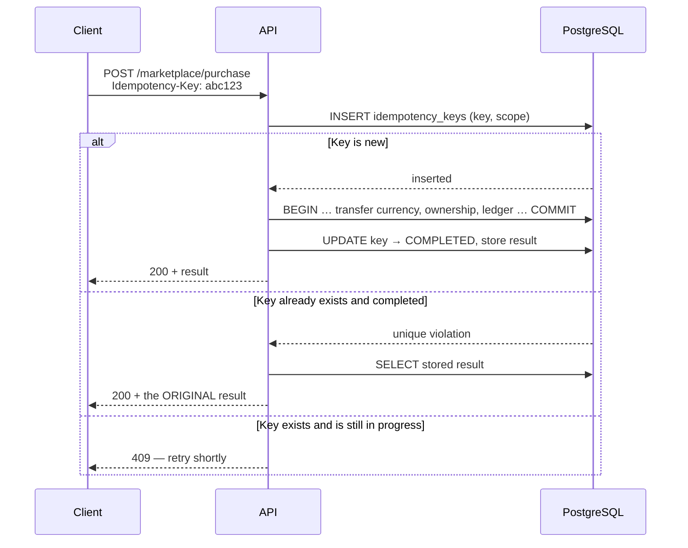

# API Architecture

> Audience: anyone adding an endpoint or a client call. Date: 2026-07-28.

---

## Style

**REST over HTTPS, JSON, versioned in the path.** Not GraphQL, not gRPC, not tRPC.

The reasoning: three clients including a released mobile app that cannot be updated in
lockstep with the server; a small team; and a hard requirement that every mutation be
individually authorised, rate-limited and idempotent. REST makes each of those a property of
a URL, which is the easiest thing to audit and the easiest thing to cache and rate-limit at
the edge. GraphQL would give clients query flexibility they have not asked for, at the cost
of per-field authorization and unbounded query complexity.

---

## Route structure

```text
/health                      liveness — outside versioning
/ready                       readiness — outside versioning
/docs                        OpenAPI UI — non-production only
/api/v1/<domain>/<resource>  everything else
```

Health and readiness sit **outside** `/api/v1` on purpose: an orchestrator's probe must not
break when the API version changes.

`/docs` is generated in every environment but **served only outside production**. The schema
is a precise map of the attack surface; publishing it is a gift to whoever is looking.

### Versioning

The version is in the path (`/api/v1/`). A released mobile build keeps calling `v1` after
`v2` ships.

Breaking changes create a new version. Non-breaking changes (adding an optional field,
adding an endpoint) do not. Removing a version requires a deprecation window measured in
months, because there is no way to force an app update.

---

## Request

### Headers

| Header                           | When                           | Purpose                                       |
| -------------------------------- | ------------------------------ | --------------------------------------------- |
| `Authorization: Bearer <token>`  | Authenticated requests         | Identity                                      |
| `Accept-Language`                | Always                         | Locale for server-rendered messages           |
| `X-Correlation-Id`               | Optional                       | Client-side tracing; validated, never trusted |
| `Idempotency-Key`                | **Required** on economy writes | Makes a retry safe                            |
| `Content-Type: application/json` | With a body                    |                                               |

### Validation

Every body, query and path parameter is parsed against a Zod schema before the handler runs.
A failure returns `400` with the failing field paths — and **never** the submitted value,
because echoing a rejected payload is how passwords reach error trackers.

Bodies are capped at 1 MiB. An unbounded body is a trivial memory-exhaustion vector.

---

## Response

### Success

The resource, directly. No envelope:

```json
{ "id": "018f...", "name": "…", "level": 12 }
```

An envelope like `{ "data": ..., "success": true }` restates the HTTP status code in the body
and adds a level of nesting to every client access path, for no gain.

### Error — one shape, everywhere

```json
{
  "error": {
    "category": "PRECONDITION_FAILED",
    "code": "INSUFFICIENT_FUNDS",
    "message": "Not enough gold",
    "messageKey": "error.insufficient_funds",
    "details": { "currency": "GOLD" },
    "correlationId": "018f4c1a-..."
  }
}
```

- **`code`** is stable and machine-readable. Clients branch on it, never on message text.
- **`messageKey`** lets the client render the error in the player's own language.
- **`message`** is developer-facing English for logs, and is **not** shown to players.
- **`details`** contains only what the caller is already entitled to see.
- **`correlationId`** ties a player's report to a server log line.

Enforced globally by `AllExceptionsFilter`. A `5xx` never carries an internal message: the
detail goes to the log, the client gets `"An unexpected error occurred"` and the
correlation id.

### Status codes

| Code            | Meaning here                                                    |
| --------------- | --------------------------------------------------------------- |
| 200 / 201 / 204 | Success                                                         |
| 400             | Validation failed                                               |
| 401             | Not authenticated, or token expired                             |
| 403             | Authenticated but not permitted                                 |
| 404             | Not found **or not yours** — deliberately indistinguishable     |
| 409             | Conflict: stale write, already claimed, already sold            |
| 422             | Precondition failed: insufficient funds, insufficient inventory |
| 429             | Rate limited                                                    |
| 500             | Unexpected                                                      |
| 503             | A dependency is unavailable                                     |

> **404 for "not yours" is deliberate.** Distinguishing it from "does not exist" lets an
> attacker enumerate other players' resource identifiers.

---

## Idempotency

**Every economy-affecting write requires an `Idempotency-Key`.**



Two properties make this actually safe:

**The database enforces uniqueness, not the application.** A check-then-insert in
application code is a race, and under concurrency that race resolves as a double spend.

**Keys are scoped by operation.** Without a scope, a client reusing one key across two
different operations would receive the wrong cached result from the second.

Keys are retained for a bounded window — long enough to cover a late retry, not forever.

---

## Pagination

**Cursor-based**, for every list that can grow.

```http
GET /api/v1/marketplace/listings?limit=20&cursor=eyJ...
```

```json
{ "items": [...], "nextCursor": "eyJ...", "hasMore": true }
```

Offset pagination is wrong here for two reasons:

- **Correctness.** Rows shift between requests. A listing sold while the player is on page 2
  silently hides an unrelated listing they never saw.
- **Cost.** `OFFSET 10000` makes the database walk 10,000 rows it then discards.

The cursor is opaque and server-signed. A client that decodes or fabricates one gets a `400`,
not a different slice of data. `limit` is **clamped** to the server maximum rather than
rejected — asking for 100,000 returns 100, which is friendlier than an error and still
protects the database.

---

## Rate limiting

Per authenticated player and per IP, in Redis, with limits scaled to the risk of the
endpoint rather than applied uniformly:

| Endpoint class     | Rationale                                                   |
| ------------------ | ----------------------------------------------------------- |
| Authentication     | Tightest — credential stuffing is the highest-volume attack |
| Economy writes     | Tight — limits the blast radius of an exploit               |
| Ordinary reads     | Loose                                                       |
| Health / readiness | Exempt — an orchestrator probe must never be throttled      |

A rate-limited response is `429` with `Retry-After`.

---

## Authentication and authorization

Bearer JWT access tokens (short-lived) plus refresh tokens (long-lived, revocable). On
mobile, refresh tokens live in Keychain / Keystore.

**Authorization is checked per operation, server-side, deny-by-default.** A new endpoint is
unreachable until it declares who may call it. Hiding a control in the UI is not access
control.

See [authentication model](../security/AUTHENTICATION_MODEL.md) and
[authorization model](../security/AUTHORIZATION_MODEL.md).

---

## Correlation ids

Every request gets one — adopted from `X-Correlation-Id` if well-formed, minted otherwise —
and it is echoed back on the response.

The incoming value is validated before use, because it is written into log lines: an
unvalidated header is a log-injection and log-flooding vector. Anything malformed is
silently replaced rather than rejected, since a bad trace header should not fail a player's
request.

---

## The client contract

Clients use `@collection-war/api-client` and nothing else. It centralises correlation ids,
the error shape, idempotency keys, timeouts, token attachment and response parsing — so
those are consistent across three applications instead of re-implemented three times with
three different bugs.

**Responses are parsed, not cast.** `as HealthResponse` would compile happily against a
server that changed its contract, and the failure would surface later as an undefined
property somewhere unrelated.

One deliberate exception exists: `/ready` answers `503` when a dependency is down, and that
body is still parsed (`treatStatusAsSuccess: [503]`) because the dependency detail is
exactly what the caller asked for.

---

## WebSockets

**Not implemented.** Reserved for notification delivery and live status if polling proves
insufficient — never for gameplay. Battles resolve asynchronously and server-side; a
WebSocket would not change that. See [non-goals](../product/NON_GOALS.md).

---

## Client generation

OpenAPI is generated from the NestJS decorators. Generating TypeScript clients from it is
attractive and **deliberately deferred**: a generated client is only as good as the
annotations, and hand-writing the small current surface keeps the error handling and
idempotency semantics explicit. Revisit when the endpoint count makes hand-writing the cost.

Related: [Security architecture](SECURITY_ARCHITECTURE.md) ·
[Event architecture](EVENT_ARCHITECTURE.md) · [Shared kernel](../domains/SHARED_KERNEL.md)
