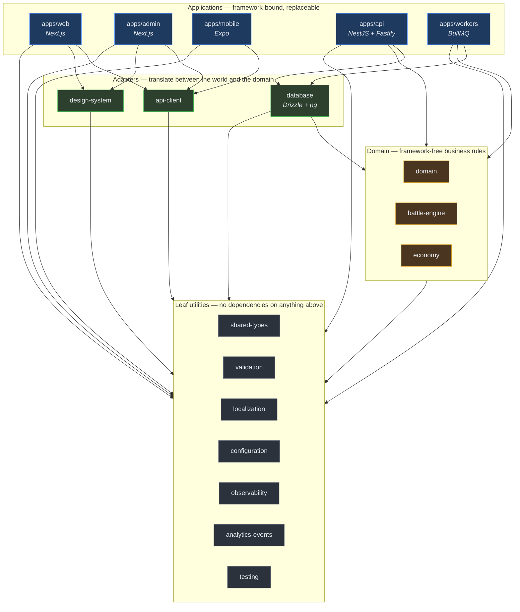
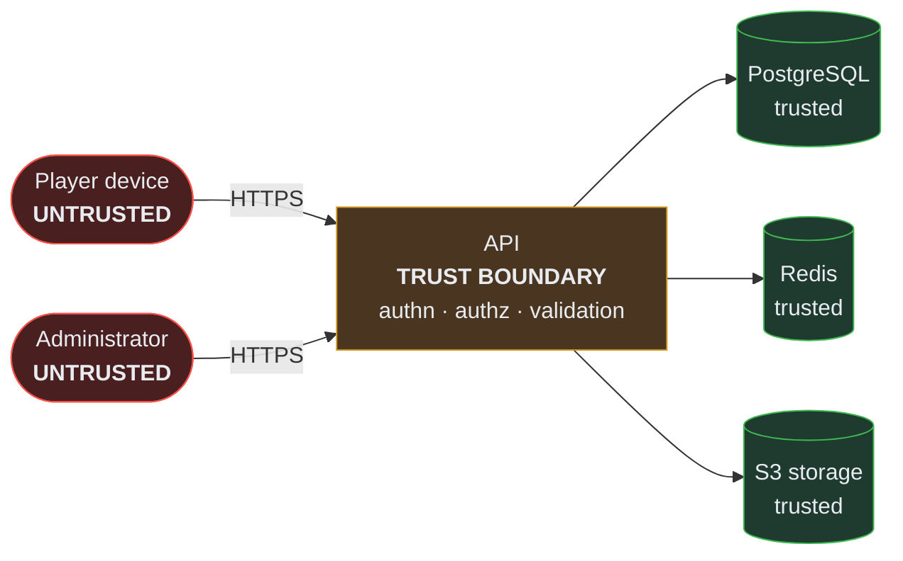

# Architecture Overview

> Audience: anyone who needs to understand how Collection War is built before changing it.
> Date: 2026-07-28. Reflects the repository as it actually exists.

---

## Architectural style

**A modular monolith in a TypeScript monorepo, with a strict inward dependency rule.**

- One authoritative API process, one worker process, three client applications.
- One PostgreSQL database as the single source of truth.
- Redis for cache and queue only — never for durable player state.
- Framework-free domain packages that the outer layers depend on, not the reverse.

Chosen over microservices deliberately. See
[ADR-0005](../adr/ADR-0005-modular-monolith.md) and
[architecture principles](../constitution/ARCHITECTURE_PRINCIPLES.md#1-modular-monolith-first-and-for-a-long-time).

## The layer rule, in one picture

**Arrows only ever point downward.** Enforced by `no-restricted-imports` rules in
`eslint.config.mjs`, which were verified to fire by deliberately introducing violations.
See [dependency rules](DEPENDENCY_RULES.md).

## Applications

| Application        | Responsibility                                                       | Stack                                           | State today                                                            |
| ------------------ | -------------------------------------------------------------------- | ----------------------------------------------- | ---------------------------------------------------------------------- |
| **`apps/api`**     | The only authority. Owns all business decisions and all writes.      | NestJS 11 on Fastify 5, OpenAPI, Pino           | Health, readiness, system info. **Verified running.**                  |
| **`apps/workers`** | Background processing: outbox relay, scheduled state, notifications. | BullMQ 5, ioredis                               | Lifecycle only. **No job processors registered.**                      |
| **`apps/web`**     | Player-facing web client.                                            | Next.js 16 App Router, React 19, TanStack Query | Health screen, locale switch. **Builds and tested.**                   |
| **`apps/admin`**   | Administration console.                                              | Next.js 16, hardened headers                    | Route guard that denies everything. **No authentication exists.**      |
| **`apps/mobile`**  | Android and iOS client.                                              | Expo 57, React Native 0.86, expo-router         | Health screen. **Typechecked and unit-tested; never run on a device.** |

## Shared packages

| Package            | Responsibility                                                                                     | May depend on                                      |
| ------------------ | -------------------------------------------------------------------------------------------------- | -------------------------------------------------- |
| `shared-types`     | The shared kernel: ids, money, time, locale, result, errors, audit. **Zero runtime dependencies.** | nothing                                            |
| `validation`       | Zod schemas and boundary parsing                                                                   | shared-types                                       |
| `configuration`    | Typed, validated environment config; fails fast at startup                                         | shared-types, validation                           |
| `localization`     | Catalogue, locale resolution, locale-aware formatting                                              | shared-types                                       |
| `observability`    | Structured logging, redaction, correlation ids                                                     | shared-types                                       |
| `analytics-events` | The typed analytics event contract                                                                 | shared-types, validation                           |
| `domain`           | Repository interfaces, domain events, outbox contract, unit of work, clock, seeded random          | shared-types                                       |
| `battle-engine`    | Deterministic battle resolution. **Contract only today.**                                          | domain, shared-types                               |
| `economy`          | Exact integer money arithmetic, ledger contract, executable invariants                             | domain, shared-types                               |
| `database`         | Drizzle schema, pool, transactions, migrations. **The only package that knows SQL exists.**        | domain, configuration, observability, shared-types |
| `api-client`       | The only sanctioned client→server path                                                             | shared-types, validation                           |
| `design-system`    | Tokens and React DOM primitives (web + admin)                                                      | shared-types                                       |
| `testing`          | Deterministic fakes and assertions. **Test-only.**                                                 | shared-types                                       |

## Communication patterns

**Client → API.** HTTPS/JSON through `@collection-war/api-client`. Every response is
_parsed_ against a schema, not cast. See [API architecture](API_ARCHITECTURE.md).

**API → database.** Through repository interfaces the domain declares and the database
package implements. Multi-step operations run inside a unit of work.

**API → workers.** Never directly. The API writes an outbox row **inside its transaction**;
a relay delivers it. See [event architecture](EVENT_ARCHITECTURE.md).

**Module → module.** A direct call through a public interface when the caller needs the
result; a domain event when it does not. Never by reaching into another module's tables.

## Data ownership

One database, but each module owns its tables. Another module reads them **through the
owning module's interface**, never with a direct join.

This is the discipline that makes a future extraction possible. Without it, the monolith
becomes a mud ball and the boundaries exist only in documentation.

Platform tables (`outbox`, `idempotency_keys`) are shared infrastructure and are the
exception.

## Security boundaries

Everything arriving at the API is untrusted, including from our own applications — an app
binary can be unpacked and its requests replayed. See
[security architecture](SECURITY_ARCHITECTURE.md).

## Deployment assumptions

**Today: none.** Nothing is deployed and no hosted infrastructure exists. Local development
runs on Docker Compose at zero cost.

When a hosted environment is created, the assumption is the smallest thing that works: one
container platform running the API and worker images, one managed PostgreSQL, one managed
Redis, one S3-compatible bucket. See [deployment architecture](DEPLOYMENT_ARCHITECTURE.md)
and [cost strategy](COST_STRATEGY.md).

## Scaling assumptions

The API is **stateless**, so the first scaling move is horizontal replicas behind a load
balancer. Sessions live in tokens; cache and queue live in Redis; durable state lives in
PostgreSQL.

The first real bottleneck is expected to be the database, and the response order is:
indexes → query fixes → read replicas for read-heavy paths → caching → only then anything
architectural. See [scaling strategy](SCALING_STRATEGY.md).

## Explicit non-goals

Microservices · Kubernetes · a message broker · multi-cloud · event sourcing outside the
ledger · offline play · real-time multiplayer · a desktop client · a plugin system.

Full reasoning in [non-goals](../product/NON_GOALS.md).

---

Related: [System context](SYSTEM_CONTEXT.md) · [Containers](CONTAINER_ARCHITECTURE.md) ·
[Components](COMPONENT_ARCHITECTURE.md) · [Module boundaries](MODULE_BOUNDARIES.md)
