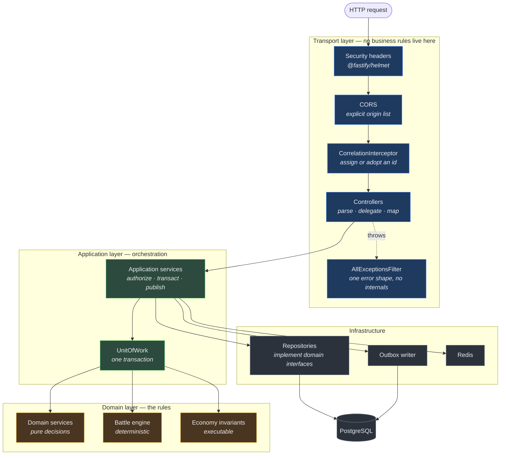
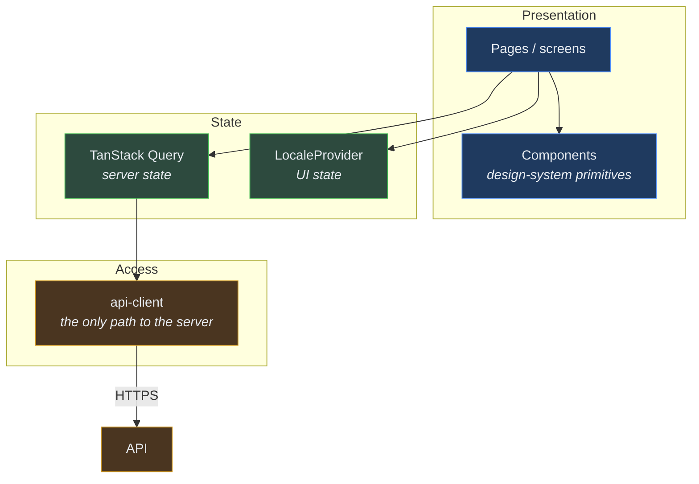
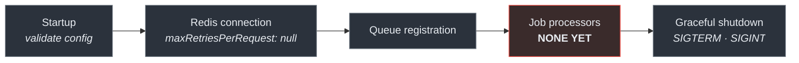

# Component Architecture (C4 Level 3)

> Audience: anyone adding a module to the API or a package to the monorepo.
> Date: 2026-07-28.

---

## Inside the API



### What each layer may and may not do

**Transport.** Parses input, calls an application service, maps the result to a response.
It may **not** contain a business rule. If a controller decides whether a player can afford
something, that rule is now untestable without HTTP and invisible to the worker process that
also needs it.

**Application.** Orchestrates one use case: authorize, open a transaction, call domain
logic, persist, enqueue an outbox event, return. It holds _sequence_, not _rules_.

**Domain.** The rules. No I/O, no framework, no clock, no ambient randomness. Testable in
milliseconds without a database.

**Infrastructure.** Implements the interfaces the domain declares. The only layer that knows
SQL exists.

### The shape every future domain module takes

```text
apps/api/src/<domain>/
├── <domain>.module.ts        Nest module — wiring only
├── <domain>.controller.ts    Transport: routes, parsing, response mapping
├── <domain>.service.ts       Application: orchestration, transactions
├── dto/                      Zod schemas for request and response
└── *.test.ts                 Direct-construction unit tests
```

Domain rules live in `packages/domain/`, not here. Repository implementations live in
`packages/database/`, not here.

> **At bootstrap only `health/` and `system/` exist.** No game module has been created,
> because no domain specification has been approved. See [backlog](../tasks/BACKLOG.md).

---

## Inside a client application



Two rules that keep client state from becoming a second source of truth:

**Server state and UI state are different things.** TanStack Query owns anything the server
knows (balances, inventory, listings) with a bounded staleness. React state owns only what
the server does not care about (which tab is open). Putting a balance in React state creates
a second, wrong copy.

**The `QueryClient` is created per component instance, never at module scope.** A
module-level client is shared across every request during server rendering — which means one
player's cached data can be served to another. That is a real data-leak class, and the
comment saying so is in `providers.tsx`.

---

## Inside the worker process



Graceful shutdown is not a nicety. A worker killed mid-job can be terminated between
debiting a player's gold and crediting their inventory — precisely the state the
transactional design exists to prevent. The forced-exit timer exists because an
orchestrator will `SIGKILL` eventually anyway, and exiting deliberately with a logged reason
beats being killed silently.

---

## Cross-cutting components

| Concern            | Where it lives        | Applies at                                         |
| ------------------ | --------------------- | -------------------------------------------------- |
| Correlation id     | `observability`       | Every request, job and log line                    |
| Structured logging | `observability`       | All server code (`console` is lint-blocked)        |
| Secret redaction   | `observability`       | The logger itself — deny-by-default by key pattern |
| Configuration      | `configuration`       | Process start, before anything else is constructed |
| Validation         | `validation`          | Every trust boundary                               |
| Localization       | `localization`        | All user-facing text in all three clients          |
| Error shape        | `shared-types`        | Every non-2xx response                             |
| Idempotency        | `domain` + `database` | Every economy-affecting write                      |

Related: [Module boundaries](MODULE_BOUNDARIES.md) · [Dependency rules](DEPENDENCY_RULES.md) ·
[API architecture](API_ARCHITECTURE.md)
