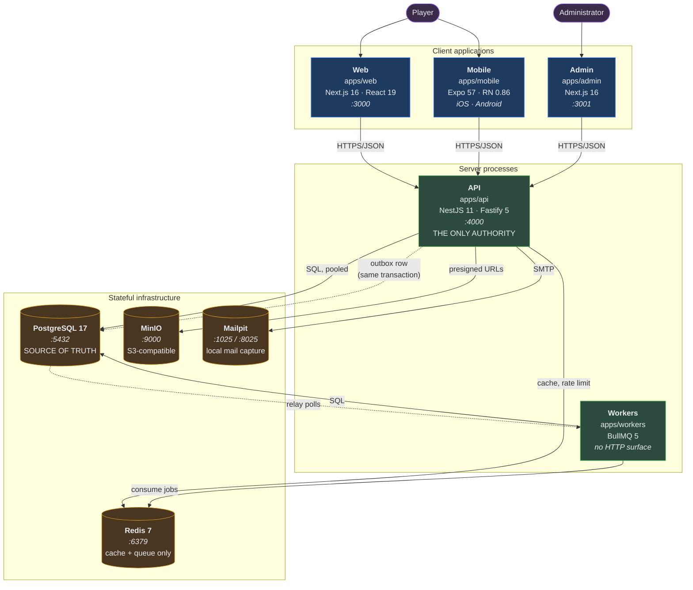

# Container Architecture (C4 Level 2)

> Audience: anyone deploying, debugging or adding a runtime component. Date: 2026-07-28.
> Every container below corresponds to something in this repository.

---

---

## Server containers

### API — `apps/api`

The only process permitted to make a business decision.

|                 |                                                                                         |
| --------------- | --------------------------------------------------------------------------------------- |
| Runtime         | Node 22, NestJS 11 on Fastify 5                                                         |
| Port            | 4000                                                                                    |
| State           | **Stateless.** Scales horizontally without coordination.                                |
| Depends on      | PostgreSQL (required) · Redis (required) · S3 (later) · SMTP (later)                    |
| Endpoints today | `GET /health` · `GET /ready` · `GET /api/v1/system/info` · `GET /docs` (non-production) |

Startup order is deliberate: configuration is validated _first_, so an invalid environment
kills the process before it binds a port; security headers are registered before any route
exists; shutdown hooks are enabled before listening.

**Verified running** during the bootstrap — see [bootstrap report](../status/BOOTSTRAP_REPORT.md).

### Workers — `apps/workers`

|                       |                                                              |
| --------------------- | ------------------------------------------------------------ |
| Runtime               | Node 22, BullMQ 5                                            |
| Port                  | none — no HTTP surface, and therefore no HTTP attack surface |
| State                 | Stateless; work lives in Redis and PostgreSQL                |
| Registered processors | **Zero.** Lifecycle only, by design.                         |

Separate from the API because a long job must not compete with request handling for the
event loop, because the two scale on different signals, and because a crashing job must not
take down request serving.

Planned queues (declared, not served): `outbox-relay` · `notifications` · `scheduled` ·
`analytics` · `maintenance`.

---

## Client containers

|           | Web                                                            | Mobile                            | Admin                                                              |
| --------- | -------------------------------------------------------------- | --------------------------------- | ------------------------------------------------------------------ |
| Framework | Next.js 16 App Router                                          | Expo 57 / RN 0.86                 | Next.js 16                                                         |
| Rendering | Server-rendered per request                                    | Native                            | Server-rendered per request                                        |
| Locale    | Cookie + `Accept-Language`, resolved server-side               | SecureStore + device locale       | Session preference                                                 |
| Storage   | Cookie (preference only)                                       | SecureStore (Keychain / Keystore) | Cookie                                                             |
| Hardening | `nosniff`, `DENY` framing, referrer policy, permissions policy | Platform sandbox                  | The above **plus** `frame-ancestors 'none'`, `no-store`, `noindex` |

The admin application is hardened further because it is the higher-value target: an admin
session can move currency.

---

## Stateful infrastructure

### PostgreSQL 17 — the source of truth

Everything durable. Initialised with `--locale=C` so ordering is deterministic and does not
depend on the host locale — which matters here, since the bootstrap machine runs `tr_TR` and
Turkish casing rules differ from C.

Tables today: `outbox`, `idempotency_keys`. Both are platform infrastructure. No game schema
exists yet, deliberately.

### Redis 7 — cache and queue, never truth

Job queue, cache, rate-limit counters, ephemeral state. Configured with `appendonly yes` so
queued jobs survive a restart, and `maxmemory-policy noeviction` so a full Redis fails loudly
instead of silently discarding jobs.

**A Redis restart must be an availability event, never a data-loss event.** If losing Redis
would lose something a player owns, that thing is in the wrong place.

### MinIO — S3-compatible storage

Local stand-in for any S3 API. Keeps the application cloud-neutral: the same calls work
against AWS S3, Cloudflare R2 or Backblaze B2. See
[ADR-0012](../adr/ADR-0012-s3-compatible-storage.md).

### Mailpit — local mail capture

Captures every outbound email locally. Nothing leaves the machine.

---

## Local port map

| Port        | Service             | Notes                                     |
| ----------- | ------------------- | ----------------------------------------- |
| 3000        | Web                 |                                           |
| 3001        | Admin               |                                           |
| 4000        | API                 | `/docs` serves OpenAPI outside production |
| 5432        | PostgreSQL          | bound to `127.0.0.1` only                 |
| 6379        | Redis               | bound to `127.0.0.1` only                 |
| 8025        | Mailpit UI          |                                           |
| 8081        | Expo dev server     |                                           |
| 9000 / 9001 | MinIO API / console |                                           |

Every infrastructure port binds to `127.0.0.1`, so nothing is reachable from the network —
including from another machine on the same café Wi-Fi.

---

## What does not exist

No load balancer, no reverse proxy, no CDN, no message broker, no search cluster, no metrics
stack, no container orchestrator. None is needed at zero traffic, and each would be a cost
and a maintenance burden. See [cost strategy](COST_STRATEGY.md).

Related: [Component architecture](COMPONENT_ARCHITECTURE.md) ·
[Deployment architecture](DEPLOYMENT_ARCHITECTURE.md) ·
[Local development](../runbooks/LOCAL_DEVELOPMENT.md)
