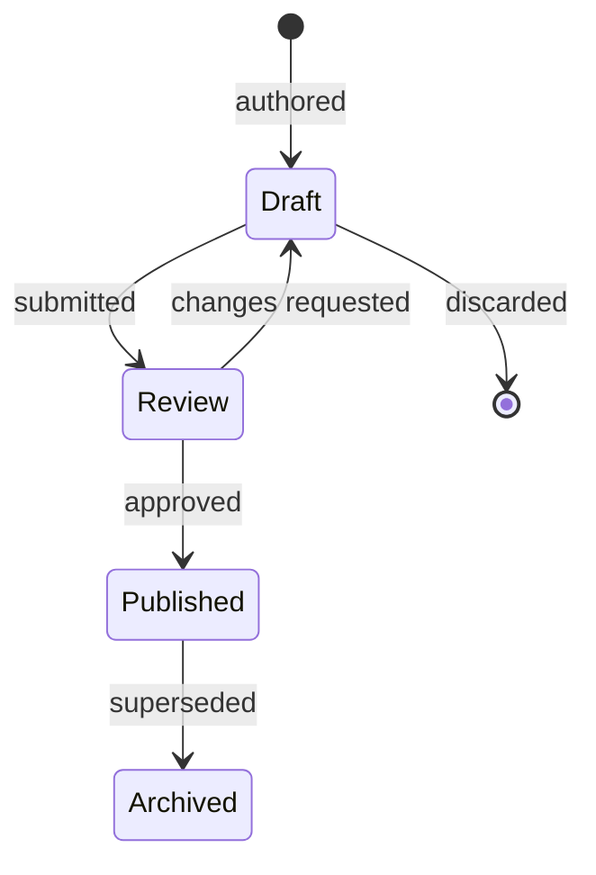

# Content Versioning

> Audience: anyone authoring game content or storing an outcome derived from it.
> Date: 2026-07-28.

---

## What counts as content

Authored data that defines the world, as opposed to what players do in it:

species · abilities · passives · personalities · variations · evolution trees · materials ·
recipes · biomes · chapters · nodes · encounters · drop tables · quests · localized text.

**None of it is hardcoded in a handler.** It is rows, with stable ids and a version.

---

## Why versioning is not optional

Two problems, both unfixable retroactively:

**1. Replay.** A battle fought in March was resolved under March's numbers. To explain it in
September, the server must know what those numbers were. Without a recorded version, replay
silently applies today's balance and produces a different answer than the player saw — which
is worse than refusing to replay at all.

**2. Client skew.** A released mobile build holds whatever content it last downloaded, and
players update on their own schedule. The server decides regardless, but it needs to know
what the client believed in order to explain a mismatch rather than argue about it.

---

## The model



A **content version** is a snapshot of all content, identified as `YYYY.MM.DD-N`
(`2026.07.28-1`).

| Rule                                                | Consequence                                     |
| --------------------------------------------------- | ----------------------------------------------- |
| A published version is **immutable**                | Changing balance means publishing a new version |
| Exactly one version is **current**                  | The server resolves "current" once per request  |
| Old versions remain **readable**                    | Replay works                                    |
| Publishing is an **administrative action**, audited | Rebalancing is not a deploy                     |

### The rule that surprises people

**Publishing a content version silently reprices the entire marketplace.** A species whose
attack rises is worth more; every listing of it was priced under the old numbers. That is why
publication is a reviewed, audited action with a justification — not a config change.

---

## Stamping outcomes

Anything computed from content records the version it used:

| Record                       | Stamps                                              |
| ---------------------------- | --------------------------------------------------- |
| `battle_sessions`            | `content_version` **and** `engine_version`          |
| `owned_creatures`            | `content_version` (creation, and last modification) |
| `inventory_transactions`     | `content_version`                                   |
| Expedition and craft results | `content_version`                                   |

Engine version and content version are **separate** because rules and numbers change
independently — see [RANDOMNESS_AND_REPLAY.md](RANDOMNESS_AND_REPLAY.md).

---

## Content in the database, not in code

```ts
// ✗ Unversionable, untestable against history, requires a deploy to rebalance,
//   and unreachable by the admin tooling.
const KORUK = { baseAttack: 42, ... };

// ✓ A row. Versioned, publishable, auditable, editable by a designer.
await db.select().from(creatureSpecies)
  .where(and(eq(creatureSpecies.slug, 'koruk'),
             eq(creatureSpecies.contentVersion, currentVersion)));
```

**Seed data is the authoring mechanism until the admin UI exists.** It is versioned content
loaded through the same path — not a special case that bypasses validation.

---

## Identifiers versus display text

> **Localized text is never an identifier.**

| Purpose           | Field                     | Example              |
| ----------------- | ------------------------- | -------------------- |
| Stable machine id | `id` (UUIDv7)             | `018f4c1a-…`         |
| Stable human key  | `slug`                    | `koruk`              |
| Display           | `name_key` → localization | `species.koruk.name` |

`slug` is what appears in seed data, admin URLs and test fixtures. `name_key` resolves to
"Koruk" in both locales — which happens to be the same string here, and would not be for a
species whose name is translated. **The catalogue completeness test covers content keys too.**

---

## Caching

Content is identical for every player and changes rarely — the ideal cache.

- Responses carry the current `contentVersion`.
- Clients cache by version and revalidate by comparing versions, not by re-fetching.
- A version change invalidates everything at once, which is correct: content is published as
  a set.

---

## Slice scope

The first vertical slice ships content version **`2026.07.28-1`** containing:

- **3 species** — Koruk, Mizu, Veyra
- **9 abilities** — one basic attack plus two actives each
- **3 passives**
- **4 materials** — Ember Seed, Fire Essence, Tide Crystal, Skyroot
- **1 chapter**, 3 nodes, 3 encounters in Crimson Rift

Loaded by seed, validated on load, immutable once published.

**Deliberately not built yet:** the draft/review workflow, the admin authoring UI, rollback
tooling. The _versioning_ must exist from the first row — the _workflow_ around it can follow.

Related: [GAME_ARCHITECTURE.md](GAME_ARCHITECTURE.md) ·
[DATA_ARCHITECTURE.md](DATA_ARCHITECTURE.md) ·
[LOCALIZATION_ARCHITECTURE.md](LOCALIZATION_ARCHITECTURE.md)
