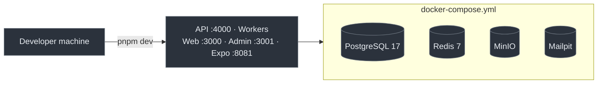
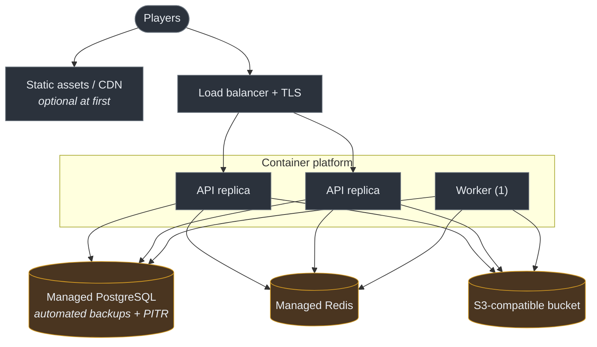

# Deployment Architecture

> Audience: whoever creates the first hosted environment. Date: 2026-07-28.
> **Nothing is deployed. No hosted infrastructure exists. No account has been created.**

---

## Current state, stated plainly

|                       |                                    |
| --------------------- | ---------------------------------- |
| Environments running  | **None**                           |
| Cloud accounts        | **None created**                   |
| Domains registered    | **None**                           |
| CI deploy workflows   | **None** — deliberately, see below |
| Cost incurred to date | **Zero**                           |

Local development runs on Docker Compose. That is the entire deployment story today, and it
is the correct one for a project with no players. See [cost strategy](COST_STRATEGY.md).

---

## Why there is no deployment pipeline

An automatic production deploy is a loaded weapon. Before one exists, all of these must:

- a hosted environment to deploy _to_;
- a rollback that has been executed, not merely written down;
- database migrations that are safe to apply while the old version is still running;
- secret management that is not a `.env` file;
- monitoring that would notice a bad deploy;
- someone who can be woken up.

None of that exists. A deploy workflow written now would be untested automation pointed at
production, which is worse than no automation at all.

The CI workflows that _do_ exist verify code. They do not ship it.

---

## Local (the only real environment today)

Application processes run on the host (fast reload); infrastructure runs in containers (real
PostgreSQL, real Redis, a real S3 API). Not SQLite, not an in-memory queue — a stack that
only works against substitutes has untested real behaviour.

> **Docker was not available on the bootstrap machine**, so the compose file has been written
> and reviewed but never started. Its health checks are unverified. See
> [bootstrap environment](../status/BOOTSTRAP_ENVIRONMENT.md).

---

## Proposed hosted topology

**Proposed, not built.** The smallest thing that could work:

**Managed PostgreSQL and Redis, not self-hosted.** Running a database well — backups,
point-in-time recovery, failover, patching — is a full-time job. Paying a provider for it is
cheaper than doing it badly, and doing it badly is how player data is lost.

**One worker replica, initially.** The outbox relay must not process the same row twice; a
single consumer avoids needing distributed claiming before there is any load to justify it.

**The API is stateless**, so replicas need no coordination.

---

## Environments

| Environment | `COLLECTION_WAR_ENV` | Data                               | Exists          |
| ----------- | -------------------- | ---------------------------------- | --------------- |
| Local       | `local`              | Disposable                         | ✅ (configured) |
| Development | `development`        | Synthetic, shared                  | ❌              |
| Staging     | `staging`            | Production-shaped, no real players | ❌              |
| Production  | `production`         | Real                               | ❌              |

`COLLECTION_WAR_ENV` is separate from `NODE_ENV` so a production-mode _build_ can run against
a development _environment_ without believing it is production — and so the application can
refuse when the combination is wrong.

Production configuration is additionally strict: wildcard CORS rejected, TLS to the database
required, the example placeholder secret rejected. Those checks are in
`packages/configuration/src/schema.ts` and are unit-tested.

---

## Build and release

**Server images.** Multi-stage: install with `--frozen-lockfile`, build, then copy only
runtime artefacts into a slim image running as a non-root user. Not written yet — there is
nothing to deploy to.

**Web and admin.** Next.js standalone output, containerised the same way.

**Mobile.** EAS Build or a local native toolchain, then store submission. **Not configured.**
An EAS project is an account-level action with cost implications, deliberately out of scope
for the bootstrap. `pnpm build` for mobile is a no-op that says so, rather than a command
that pretends to work.

---

## Migrations during deploy

The dangerous part, and the reason for the expand/contract discipline:

1. **Expand** — add the new column or table, nullable/defaulted. Old code keeps working.
2. **Deploy** the code that writes both old and new.
3. **Backfill** in batches.
4. **Deploy** the code that reads only the new.
5. **Contract** — remove the old, once nothing references it.

Steps 1 and 5 are separate deploys, sometimes days apart. A migration that drops a column in
the same release as the code that stopped using it cannot be rolled back — the old code comes
back and the column does not.

See [migrations runbook](../runbooks/MIGRATIONS.md).

---

## Rollback

**Application:** redeploy the previous image. The API is stateless, so this is fast and safe.

**Database:** you generally cannot roll back a migration that has run against real data.
Which is precisely why expand/contract exists — every intermediate state must be one the
previous version can also run against.

**An untested rollback is not a rollback.** It must be executed in staging before production
exists.

---

## Requirements before anything reaches production

- [ ] Secret management that is not a file (a managed secret store).
- [ ] Automated backups **with a tested restore**.
- [ ] Log aggregation with search.
- [ ] Alerting on error rate, readiness and economy reconciliation.
- [ ] TLS everywhere, including to the database.
- [ ] Rate limiting active.
- [ ] Authentication implemented and threat-modelled.
- [ ] An incident runbook someone has actually read.
- [ ] A rollback executed in staging.

Related: [Cost strategy](COST_STRATEGY.md) · [Scaling strategy](SCALING_STRATEGY.md) ·
[Releases](../runbooks/RELEASES.md) · [Backups](../runbooks/BACKUPS.md)
