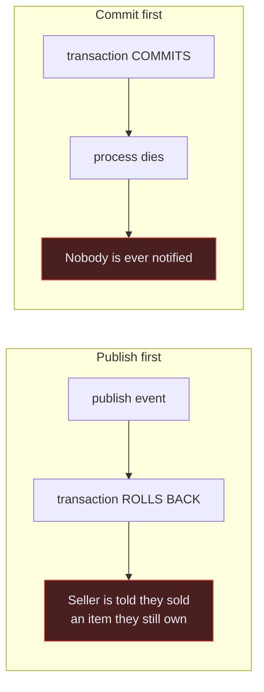

# Event Architecture

> Audience: anyone publishing or consuming a domain event, or adding a background job.
> Date: 2026-07-28.

---

## The problem this solves

A marketplace purchase must do two things:

1. commit a database transaction — currency moves, ownership transfers;
2. cause a side effect — notify the seller, update quest progress, record analytics.

These are different systems, so there is no shared transaction. Whichever you do second can
fail after the first has already succeeded:



Both are real. Both happen the first time a process is restarted at the wrong moment.

---

## The solution: a transactional outbox

Write the event as a **row**, in the same transaction as the business change.

```mermaid
sequenceDiagram
    participant API
    participant DB as PostgreSQL
    participant Relay as Outbox relay
    participant Consumer

    rect rgb(30,50,40)
    Note over API,DB: ONE TRANSACTION
    API->>DB: UPDATE wallets, owned_creatures, listings
    API->>DB: INSERT INTO outbox (event)
    API->>DB: COMMIT
    end

    Note over DB: If the transaction rolls back,<br/>the event does not exist either.

    loop poll
        Relay->>DB: SELECT … WHERE status='PENDING' AND next_attempt_at <= now()
        Relay->>Consumer: deliver
        alt delivered
            Relay->>DB: UPDATE status='PUBLISHED'
        else failed
            Relay->>DB: attempts+1, next_attempt_at = backoff
        end
    end
```



The event exists **if and only if** the business change committed. That is the entire point,
and it cannot be achieved any other way without distributed transactions.

The table is `packages/database/src/schema/outbox.ts`. It was created before any domain
table, because retrofitting reliable delivery onto a system that already fires side effects
inline is a rewrite, not a refactor.

---

## At-least-once, never exactly-once

The relay may deliver an event more than once — it can crash after delivering and before
recording success. Exactly-once delivery is not achievable across a network.

**Therefore every consumer must be idempotent.** A handler that grants a reward without
first checking whether it already did is a duplication bug waiting for its first retry.

Idempotency in a consumer means one of:

- a natural key with a unique constraint;
- checking whether the effect already exists before applying it;
- an operation that is inherently repeatable (setting a value, not incrementing one).

---

## Naming and versioning

**Events are facts, in the past tense.** `Marketplace.ListingSold`, never `SellListing`. An
event says something happened; it does not ask for something to happen.

Format: `Domain.SubjectVerbedPast`.

**Versions are not decoration.** A consumer written against v1 must keep working after v2
ships, because a queued v1 payload may still be in flight during a deploy.

- Adding an optional field → same version.
- Removing or repurposing a field, or changing a meaning → new version, and both are
  consumed until the old ones have drained.

---

## Retry, backoff and dead letters

```text
maxAttempts   8
baseDelay     1s
maxDelay      1h
strategy      exponential with FULL JITTER
```

**Jitter is not a refinement.** Without it, every message that failed during an outage
retries at the same instant when the dependency recovers, and the recovery is immediately
undone by the stampede.

After `maxAttempts`, a record moves to `DEAD_LETTER` — not dropped, not retried forever.
Dropping loses a real business fact; retrying forever turns one broken message into a
permanently saturated relay. A dead letter is something a human is alerted to and can replay.

---

## When NOT to use an event

Events are not decoupling for its own sake. Use a direct call when:

- **the caller needs the result** — an event returns nothing;
- **the operation must fail if the follow-up fails** — an event cannot roll back its
  producer;
- **it must be immediate and synchronous** — the relay adds latency by design;
- **there is exactly one consumer and there always will be** — an event adds indirection with
  no corresponding flexibility.

The mistake to avoid is publishing an event because it feels decoupled, when the caller
actually needs the answer. That converts a compile error into a silent runtime gap.

---

## Background jobs

Delivered through BullMQ on Redis. Distinct from domain events: an event is a _fact_, a job
is _work to do_.

Declared queues (none served yet):

| Queue           | Purpose                                                           | Priority                                 |
| --------------- | ----------------------------------------------------------------- | ---------------------------------------- |
| `outbox-relay`  | Deliver outbox events. **The first queue with a real processor.** | Highest                                  |
| `notifications` | Push, email, in-app                                               | High                                     |
| `scheduled`     | Expedition completion, cooldown and listing expiry                | High                                     |
| `analytics`     | Forwarding and aggregation                                        | Lowest — never blocks player-facing work |
| `maintenance`   | Idempotency-key sweeping, dead-letter reporting                   | Low                                      |

Default job options, and why each value is what it is:

```ts
attempts: 5
backoff: { type: 'exponential', delay: 1000 }
removeOnComplete: { count: 1000 }   // bounded: `false` grows Redis until it dies
removeOnFail:     { count: 5000 }   // failures kept longer — they get investigated
```

---

## Ordering

Events are **not globally ordered**, and no consumer may assume they are.

Per-aggregate ordering is achievable — the outbox is time-ordered by UUIDv7 primary key, and
a consumer can process one aggregate serially. Cross-aggregate ordering is not, and designing
as if it were produces bugs that only appear under load.

---

## No external broker

No Kafka, no RabbitMQ, no NATS. PostgreSQL plus Redis is sufficient for this scale by a wide
margin, and each of those would add an operational surface, a cost and a failure mode for
capability nobody currently needs.

Revisit if throughput genuinely exceeds what a relay polling PostgreSQL can handle — and
measure before deciding that it has. See [ADR-0020](../adr/ADR-0020-transactional-outbox.md).

---

## Bootstrap status

| Piece                                        | State                                                 |
| -------------------------------------------- | ----------------------------------------------------- |
| `outbox` table                               | **Defined.** Not migrated — no database has been run. |
| Outbox contract, retry policy, backoff       | **Implemented** in `packages/domain/src/outbox.ts`    |
| `DomainEvent`, publisher, handler interfaces | **Implemented**                                       |
| Outbox relay worker                          | **Not implemented**                                   |
| Any domain event                             | **None defined** — no domain is specified yet         |

Related: [Data architecture](DATA_ARCHITECTURE.md) ·
[Module boundaries](MODULE_BOUNDARIES.md) · [Domain map](../domains/DOMAIN_MAP.md)
