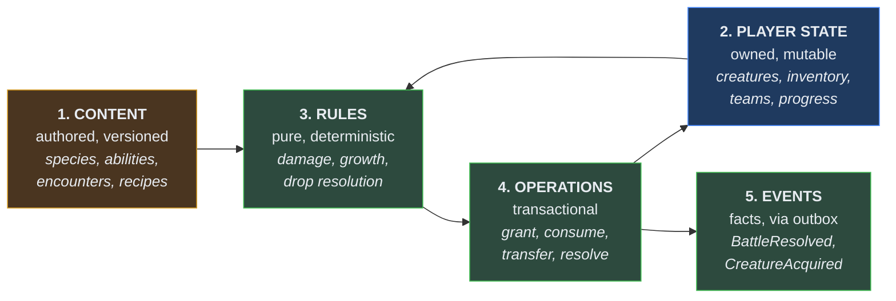
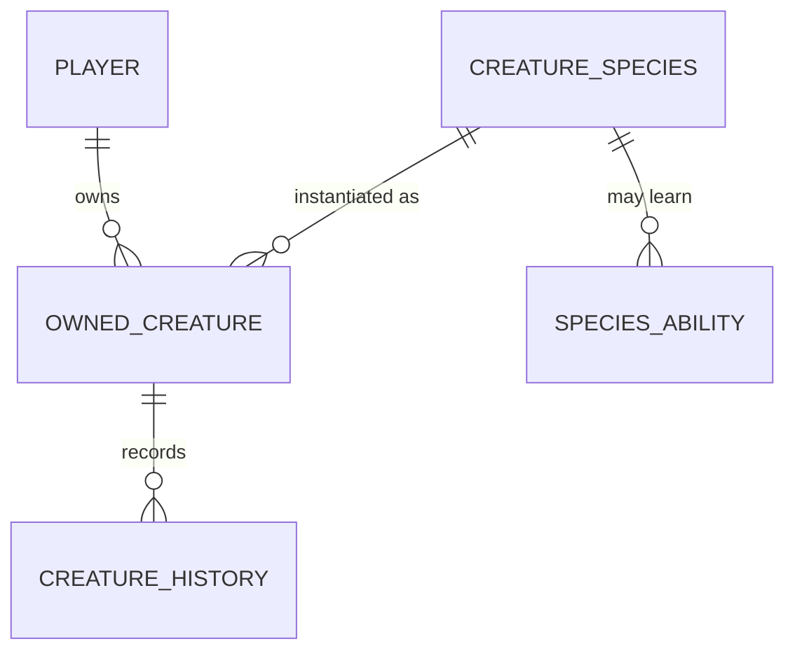
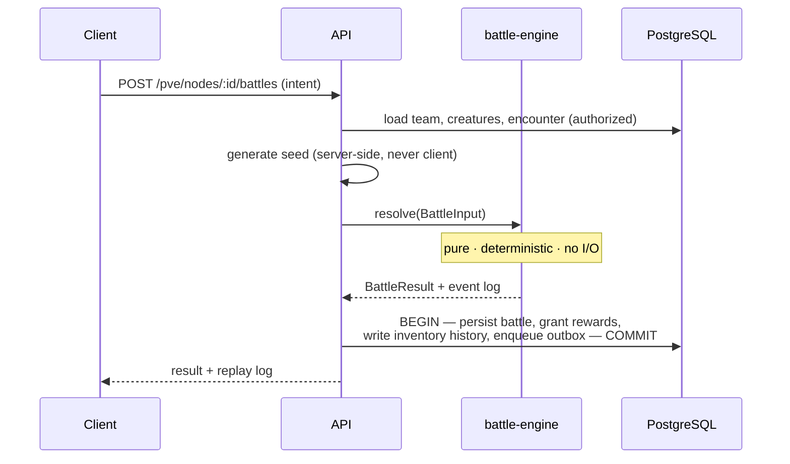
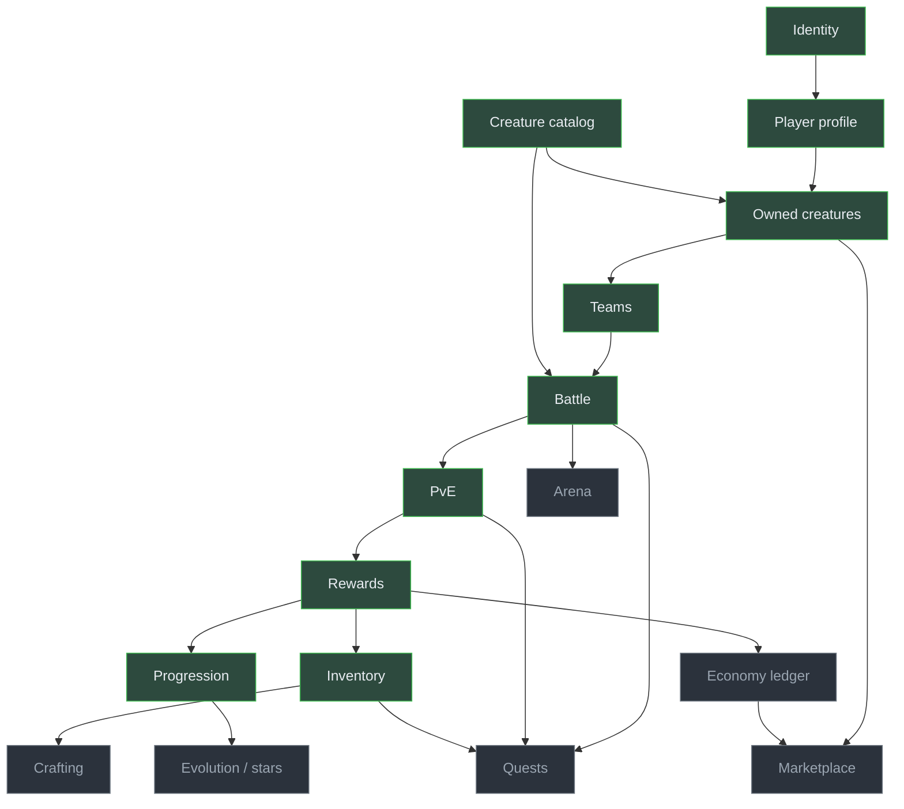

# Game Architecture

> Audience: anyone implementing a game system. Date: 2026-07-28.
> Builds on [ARCHITECTURE_OVERVIEW.md](ARCHITECTURE_OVERVIEW.md), which covers the platform.
> This covers the **game**.

---

## The shape of a game system

Every game system in Collection War is built from the same five parts. Recognising them makes
each new system a variation rather than an invention.



**1. Content** — authored data with a stable id and a version. Never hardcoded in a handler.
**2. Player state** — what a player owns. Mutable, versioned, audited.
**3. Rules** — pure functions in `packages/domain` and `packages/battle-engine`. No I/O.
**4. Operations** — application services. Authorize, transact, mutate, publish.
**5. Events** — facts other systems react to, delivered through the outbox.

If a proposed system does not decompose into these five, it is either mis-designed or belongs
inside an existing system.

---

## Where each concern lives

| Concern                                       | Layer        | Package                              |
| --------------------------------------------- | ------------ | ------------------------------------ |
| Damage formula, turn order, status resolution | Rules        | `battle-engine`                      |
| Experience curve, level gates, growth         | Rules        | `domain`                             |
| Drop resolution, seeded rolls                 | Rules        | `domain`                             |
| Species, abilities, encounters, materials     | Content      | `database` (rows) + `domain` (types) |
| Owned creatures, inventory, teams             | Player state | `database`                           |
| "Resolve a battle and grant its rewards"      | Operation    | `apps/api` service                   |
| "A battle was resolved"                       | Event        | `domain` → outbox                    |

**A formula appears exactly once.** The client may predict; the server decides. If web,
mobile and API each compute damage, they will disagree, and the player will be told three
different numbers.

---

## The vertical slice pattern

Every game feature is built as a thin complete slice, in this order:

```text
1. Content definition       what exists in the world
2. Data model               how player state is stored
3. Domain rules (+ tests)   the pure decisions — fast to test, so test here first
4. Repository               persistence
5. Application service      authorize → transact → mutate → publish
6. API endpoint             parse → delegate → map
7. API client               typed access
8. UI (web, then mobile)    including loading, empty and error states
9. Tests at every level
```

Steps 3 and 9 are where the value is. Steps 6 and 7 are mechanical.

---

## Creature model: definition versus instance

The single most important modelling decision in the game.



**Species** is authored, immutable per content version, shared by every player. It answers
_what kind of creature is this?_

**Owned creature** is a player's instance, with its own level, history and identity. It
answers _whose creature is this, and what has happened to it?_

Merging them makes per-player state impossible to version against catalogue changes — and
catalogue changes are certain, because balance changes.

An owned creature stores a **`content_version`**, so its stats can always be computed against
the species data it was created and last modified under.

---

## Stat computation

Effective stats are **derived, never stored**:

```text
effective = f(species base, growth curve, level, potential, stars, evolution stage,
              personality, variation, content version)
```

Stored stats would drift out of sync with the content version the moment a balance change
shipped. A derived stat is always correct for the version it is computed against.

The function is pure and lives in `packages/domain`. The battle engine calls it; it does not
reimplement it.

Integer arithmetic throughout, with explicit rounding — see
[RANDOMNESS_AND_REPLAY.md](RANDOMNESS_AND_REPLAY.md).

---

## Battle architecture



**The whole battle resolves in one server call.** The client submits intent and receives a
result plus a replay log, which it animates. It never submits per-turn actions for a PvE
battle, because there is no reason to give it that surface.

Live turn-by-turn submission is only needed for live PvP, which
[ADR-0027](../adr/ADR-0027-asynchronous-arena.md) explicitly defers.

---

## Reward architecture

Rewards are the highest-risk ordinary operation in the game: they create value from nothing.

Every reward grant is:

- **server-computed** — the client never states what it won;
- **idempotent** — a client-supplied key, enforced by a unique index;
- **transactional** — experience, materials and history commit together;
- **audited** — with the source that produced it;
- **event-emitting** — so quests and analytics react without being called.

```text
grantRewards(playerId, rewards, sourceType, sourceId, idempotencyKey, tx)
```

`sourceType` + `sourceId` (`battle` + battle id) makes every material in a player's inventory
traceable to the thing that produced it.

---

## System dependency order

Systems depend on each other in a fixed order. Building out of order means building against
something that does not exist.



**Green is the first vertical slice.** It is the shortest path from nothing to a complete
playable loop, and everything else attaches to it.

---

## What the client is allowed to do

| Client may                   | Client may not                         |
| ---------------------------- | -------------------------------------- |
| Render state the server sent | Compute a value the server then trusts |
| Predict, to feel responsive  | Decide an outcome                      |
| Cache content by version     | Cache player state as authoritative    |
| Animate a replay log         | Produce a replay log                   |
| Validate input for UX        | Be the only validation                 |

The server's answer always wins, and disagreement is resolved in its favour without argument.

Related: [GAME_STATE_OWNERSHIP.md](GAME_STATE_OWNERSHIP.md) ·
[RANDOMNESS_AND_REPLAY.md](RANDOMNESS_AND_REPLAY.md) ·
[TRANSACTION_BOUNDARIES.md](TRANSACTION_BOUNDARIES.md)
