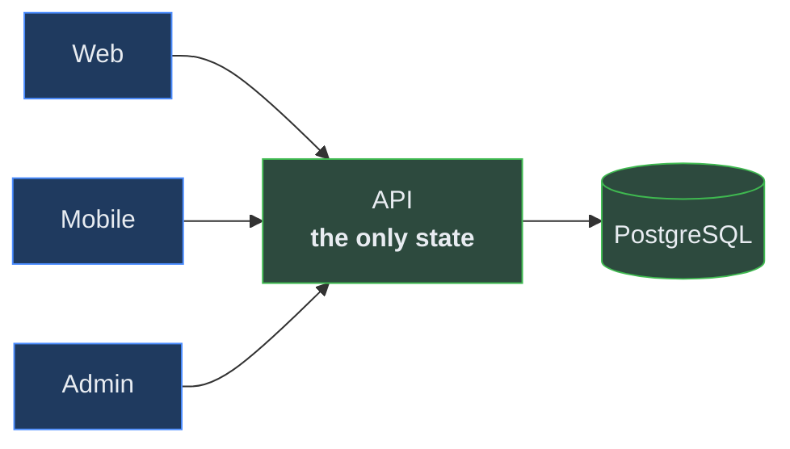

# Game Client Synchronisation

> Audience: anyone building a client screen. Date: 2026-07-28.

---

## The requirement

> Play on the web. Close it. Open the phone. Continue — same creatures, same materials, same
> team, same progress, same locale.

There is **one economy and one authoritative state**. There is no "mobile save".

---

## How it works

There is no synchronisation protocol, because there is nothing to synchronise.



**Clients hold no authoritative state.** They hold a cache of what the server last said. A
client that stored progress locally and reconciled later would need conflict resolution — and
"I levelled up on my phone and my browser disagrees" has no correct answer.

---

## Cache policy

| Data                          | Staleness                         | Invalidated by            |
| ----------------------------- | --------------------------------- | ------------------------- |
| Content (species, encounters) | Until the content version changes | Version comparison        |
| Owned creatures               | 30s                               | Any mutation              |
| Inventory                     | 30s                               | Any reward or consumption |
| Teams                         | 30s                               | Team mutation             |
| PvE progress                  | 30s                               | Battle completion         |
| Profile / settings            | 60s                               | Profile mutation          |
| Battle result                 | **Never cached**                  | —                         |

Implemented with TanStack Query on every client. **Any mutation invalidates the queries it
affects**, so the next read is authoritative rather than eventually correct.

---

## Optimistic updates

Permitted only where being wrong is harmless.

| Optimistic              | Never optimistic            |
| ----------------------- | --------------------------- |
| Favourite / unfavourite | Battle outcome              |
| Nickname                | Reward grant                |
| Locale switch           | Level-up                    |
| Team reorder (visual)   | Starter selection           |
|                         | Anything that creates value |

The test: **if the server disagreed, would the player have been shown something false about
what they own?** If yes, wait for the server.

---

## Locale

Locale is **server-side player state**, not a device setting.

```text
first launch  → detect device language → tr-TR for Turkish devices, else en
player picks  → PUT /profile/settings/locale → stored server-side
other client  → reads the stored preference, not the device
```

Storing it only on the device would mean switching to English on the web and finding Turkish
on the phone. **An explicit choice always beats anything inferred**, on every device.

---

## Handling failure

| Situation                | Behaviour                                                |
| ------------------------ | -------------------------------------------------------- |
| Request fails            | Show an error **and a retry**. Never an infinite spinner |
| Timeout                  | Bounded per request; mobile 8s, web 10s                  |
| Offline                  | Show cached data, clearly marked stale; block mutations  |
| Token expired            | Refresh silently once, then retry                        |
| Refresh fails            | Sign out cleanly to the login screen                     |
| Conflict (`STALE_WRITE`) | Re-read and let the player retry                         |

**A mutation is never silently dropped or queued for later.** A queued mutation replayed
against changed server state is how a client-side save file gets reinvented by accident.

---

## Idempotency across clients

A mobile client on a poor connection retries. Without idempotency, the retry grants a second
reward.

Every value-creating mutation carries a client-generated key:

```ts
const idempotencyKey = crypto.randomUUID(); // once per user intent, reused on retry
```

**Generated once per intent, not once per request.** Regenerating it on retry defeats the
mechanism entirely — which is the single most common way idempotency is implemented wrongly.

---

## Real-time

**Not used.** Polling with TanStack Query is sufficient for everything in the release scope:
PvE is synchronous, the arena is asynchronous
([ADR-0027](../adr/ADR-0027-asynchronous-arena.md)), and nothing else needs sub-second
freshness.

WebSockets would add authentication, reconnection, presence and scaling concerns for no
current benefit. When something genuinely needs push — marketplace sale alerts, expedition
completion — it will be notifications, not live state.

---

## Cross-client verification

The slice's E2E test asserts the actual requirement rather than a proxy for it:

```text
1. Register on client A, choose Turkish, choose Koruk
2. Fight the tutorial battle, gain experience and a material
3. Level Koruk up
4. Authenticate as the same player on client B
5. Assert: same creature id · same level · same materials · Turkish
```

Step 5 is the one that matters. Everything before it is setup.

Related: [API_ARCHITECTURE.md](API_ARCHITECTURE.md) ·
[LOCALIZATION_ARCHITECTURE.md](LOCALIZATION_ARCHITECTURE.md) ·
[GAME_STATE_OWNERSHIP.md](GAME_STATE_OWNERSHIP.md)
