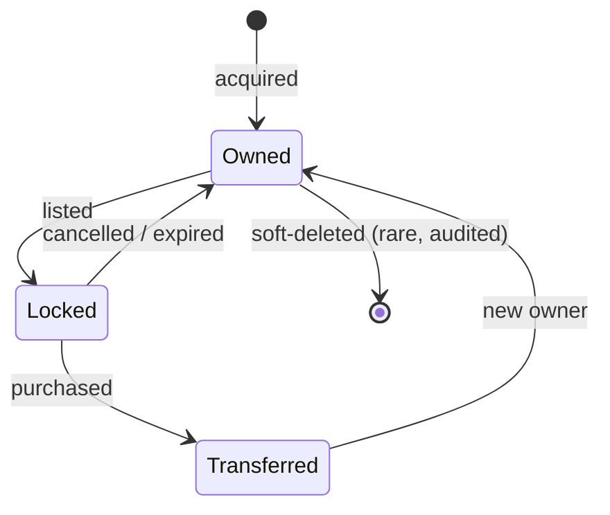

# Game State Ownership

> Audience: anyone adding a table or wondering who may write it. Date: 2026-07-28.

**Every piece of state has exactly one owning module.** Nobody else writes it, and nobody else
reads it directly — they ask the owner.

---

## The ownership table

| State                                     | Owner            | Written by                         | Read by (via interface)                 |
| ----------------------------------------- | ---------------- | ---------------------------------- | --------------------------------------- |
| `users`, `sessions`                       | identity         | identity only                      | authorization middleware                |
| `player_profiles`, `player_settings`      | player-profile   | player-profile only                | most modules (display, locale)          |
| `creature_species`, `species_abilities`   | creature-catalog | **admin content flow only**        | battle, owned-creatures, progression    |
| `owned_creatures`                         | owned-creatures  | owned-creatures only               | teams, battle, progression, marketplace |
| `creature_history`                        | owned-creatures  | **append-only**                    | owned-creatures                         |
| `teams`, `team_members`                   | teams            | teams only                         | battle                                  |
| `material_definitions`                    | inventory        | admin content flow only            | crafting, rewards                       |
| `material_inventory`                      | inventory        | inventory only                     | crafting, marketplace                   |
| `inventory_transactions`                  | inventory        | **append-only**                    | inventory, audit                        |
| `battle_sessions`, `battle_actions`       | battle           | **append-only after creation**     | pve, arena, player-profile              |
| `pve_chapters`, `pve_nodes`, `encounters` | pve              | admin content flow only            | battle                                  |
| `player_pve_progress`                     | pve              | pve only                           | quests                                  |
| `ledger_accounts`, `ledger_entries`       | economy          | **append-only**                    | marketplace, rewards                    |
| `outbox`, `idempotency_keys`              | platform         | any module, inside its transaction | the relay                               |

---

## Content versus player state

The distinction that drives most of the schema.

|             | Content                                 | Player state                                |
| ----------- | --------------------------------------- | ------------------------------------------- |
| Authored by | Designers, via admin                    | Created by play                             |
| Shared      | By every player                         | Owned by one player                         |
| Mutability  | **Immutable per version**               | Mutable, versioned per row                  |
| On change   | New content version                     | `UPDATE ... WHERE version = ?`              |
| Backup loss | Recoverable from source                 | **Irreplaceable**                           |
| Examples    | species, abilities, encounters, recipes | owned creatures, inventory, teams, progress |

Content is cheap to reconstruct. Player state is not, which is why it is soft-deleted,
versioned and audited while content is simply republished.

---

## Ownership transfer

The only state that legitimately changes hands is an owned creature or a material stack, and
only through the marketplace.

**A locked creature cannot be used, consumed, levelled, put in a team or re-listed.** Locking
is enforced in the domain, not by hiding the button — otherwise a player could sell a creature
and keep fighting with it.

Every transition writes a `creature_history` row. History is append-only and survives
ownership change; the **new owner's bond starts fresh** while lifetime history persists, and
the previous owner's private information is never exposed.

---

## Derived state

Some state is computed rather than stored. Where it is cached, the cache is always
reconstructible.

| Derived value            | From                                        | Cached?                         |
| ------------------------ | ------------------------------------------- | ------------------------------- |
| Effective creature stats | species + level + potential + stars + stage | No — always computed            |
| Currency balance         | ledger entries                              | Yes, and **reconciled**         |
| Catalogue completion %   | collection entries vs species count         | Yes, invalidated on acquisition |
| Team power               | member effective stats                      | No                              |
| Arena rating             | match history                               | Yes                             |

**Rule:** if a cached value cannot be recomputed from an authoritative source, it is not a
cache — it _is_ the source, and it needs the full integrity treatment.

---

## Cross-module access

**Forbidden:** a cross-module join. If `battle` needs creature data it calls
`ownedCreatures.getForBattle(ids)`; it does not `JOIN owned_creatures`.

**Why it matters more in a game:** a battle touches creatures, species, teams, encounters,
inventory and progression. If each reached directly into the others' tables, a single schema
change would break six modules and nobody would ever change one again.

**Allowed:**

1. A direct call through the owning module's public interface — when the caller needs the
   result and it belongs in the same transaction.
2. A domain event — when it does not.

---

## Slice ownership

For the first vertical slice, the owning modules are:

| Module             | Owns                                                                   |
| ------------------ | ---------------------------------------------------------------------- |
| `identity`         | `users`, `user_sessions`                                               |
| `player-profile`   | `player_profiles`                                                      |
| `creature-catalog` | `creature_species`, `species_abilities`                                |
| `owned-creatures`  | `owned_creatures`, `creature_history`                                  |
| `teams`            | `teams`, `team_members`                                                |
| `inventory`        | `material_definitions`, `material_inventory`, `inventory_transactions` |
| `battle`           | `battle_sessions`, `battle_actions`                                    |
| `pve`              | `pve_nodes`, `encounters`, `player_pve_progress`                       |

Related: [GAME_ARCHITECTURE.md](GAME_ARCHITECTURE.md) ·
[MODULE_BOUNDARIES.md](MODULE_BOUNDARIES.md) ·
[TRANSACTION_BOUNDARIES.md](TRANSACTION_BOUNDARIES.md)
