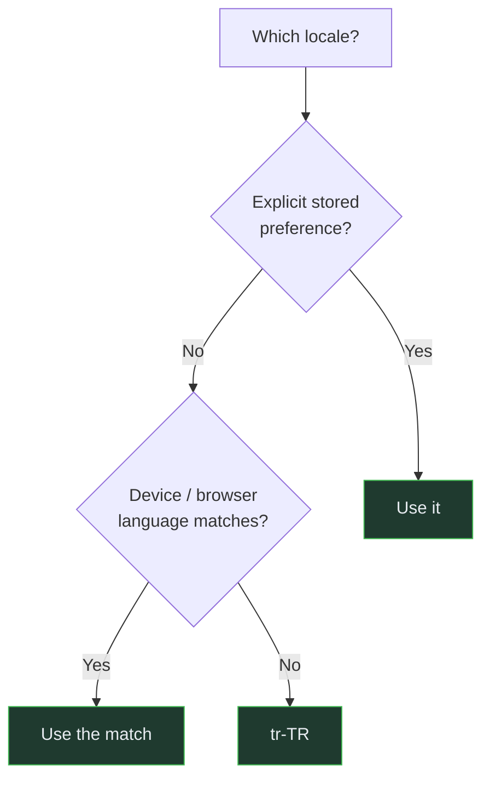

# Localization Architecture

> Audience: anyone writing user-facing text or formatting a number. Date: 2026-07-28.

---

## Locales

| Locale  | Role                                                                            |
| ------- | ------------------------------------------------------------------------------- |
| `tr-TR` | **Default.** The primary audience.                                              |
| `en`    | **Fallback.** A missing Turkish string degrades to English, never to a raw key. |

Both ship together. Turkish is not a translation layer applied to an English product.

---

## Why this is architecture and not a feature

Three things make localization structural here rather than cosmetic:

**Number formats are inverses.** Turkish writes `1.234,56` where English writes `1,234.56`.
The same digits mean different numbers. In a game with a real economy, a formatting mistake
is a _value_ mistake, not a typography one.

**Turkish casing is not ASCII casing.** `'I'.toLowerCase()` is `'ı'` under a Turkish locale,
not `'i'`. Any code that lowercases for comparison — locale matching, header parsing, a
lookup key — must specify the locale explicitly or it will break on exactly the platform this
project targets. `matchLocale` does this deliberately.

**Plural rules differ.** English distinguishes one/other; Turkish does not. A template
written as `"{n} items"` cannot be translated word for word.

---

## The rule

**No hardcoded user-facing text in any application.** Every visible string comes from a
translation key.

Enforced by review and by the fact that the shells contain no literal UI text.

Two deliberate exceptions, both in the web application, both commented in place:

- `error.tsx` and `loading.tsx` use literals, because they must render even when the failure
  was the locale provider itself.

---

## How it resolves



**An explicit choice always beats anything inferred.** Someone who switched to English on a
Turkish device did so on purpose, and silently overriding that on the next launch is a bug
they cannot work around.

Matching handles the real-world cases: an exact tag (`tr-TR`), a bare language (`tr`), and a
regional variant we do not ship (`en-GB` → `en`, `tr-CY` → `tr-TR`). `Accept-Language`
q-values are honoured.

**A stored value is re-validated on read.** It is client-controlled data and may have been
written by an older build with a different locale set.

### Per client

| Client | Resolution                                                                                                | Storage                 |
| ------ | --------------------------------------------------------------------------------------------------------- | ----------------------- |
| Web    | Server-side, from cookie then `Accept-Language`, so `<html lang>` and the first paint are already correct | Cookie (`SameSite=Lax`) |
| Mobile | Device locale synchronously, then the stored preference when SecureStore returns                          | SecureStore             |
| Admin  | Session preference                                                                                        | Session                 |

Web resolves on the server specifically to avoid rendering Turkish text into an `lang="en"`
document and visibly swapping it after hydration — bad for screen readers and bad to look at.

Mobile applies the device locale first and corrects it when storage answers, because showing
device-language text for one frame beats showing a blank screen while waiting on the keychain.

---

## Translation keys

Dotted, flat, stable: `system.api.healthy`, `error.insufficient_funds`.

**Flat rather than nested, deliberately.** A nested object makes it impossible to tell at a
glance whether `en` and `tr-TR` cover the same keys, and turns a missing translation into a
runtime `undefined` deep in a lookup rather than an obviously absent key.

**Keys are stable API.** Renaming one is a breaking change for every locale file and every
released mobile build that has not yet updated.

### The three-step fallback

1. the requested locale — the intended result;
2. English — the player sees a real sentence in a language they may not prefer;
3. **the raw key** — visibly broken, so it gets reported.

Step 3 never returns an empty string. A blank label looks deliberate and survives QA.

---

## Catalogue completeness is a test

```ts
it('translates every English key into Turkish', () => {
  expect(findMissingKeys(SHELL_MESSAGES.en, SHELL_MESSAGES['tr-TR'])).toEqual([]);
});
```

This is the guard against the most common localization defect: a key added to `en` during a
feature and never translated, which ships as English text to Turkish players.

Also tested: no key exists in Turkish that English lacks (English is the fallback), and no
translation is empty.

---

## Formatting

Everything goes through `Intl`, never through manual string building.

| Concern     | Function                       | Note                          |
| ----------- | ------------------------------ | ----------------------------- |
| Numbers     | `formatNumber`                 | Locale separators             |
| Currency    | `formatCurrencyAmount`         | Takes **integer minor units** |
| Percentages | `formatPercent`                | From a ratio                  |
| Dates       | `formatDate`, `formatDateTime` |                               |
| Durations   | `formatDuration`               | Localized units, at most two  |
| Plurals     | `pluralCategory`               | `Intl.PluralRules`            |

`Intl` formatters are cached by `(locale, options)` because constructing them is measurably
expensive and list screens would otherwise rebuild the same formatter hundreds of times per
render.

### The currency rule

`formatCurrencyAmount(locale, minorUnits, precision)` takes an **integer**. The division to a
display value happens _there_, at the very last moment, and nowhere else.

Every layer beneath — API, domain, ledger, database — deals only in integers. That is what
keeps the economy arithmetic exact. See
[economy integrity rules](../constitution/ECONOMY_INTEGRITY_RULES.md#e5-integers-only).

---

## Server-side text

Most text is translated on the client from a key. The server sends a pre-resolved string
only where it cannot be otherwise: CMS-authored content, moderation messages, and anything
whose wording depends on server data the client must not see.

API errors carry both `messageKey` (for the client to translate) and `message`
(developer-facing English, logged, never shown to a player).

---

## Content localization

Authored content — creature names, quest text, item descriptions — will carry all supported
locales at once (`LocalizedRecord`) rather than being translated at runtime, so a content
version is complete in every language or it is not shipped.

Not built. There is no content yet, and the content model is part of the next phase.

---

## Bootstrap status

- Shared localization package with catalogue, resolution, formatting: **implemented and
  tested** (23 tests).
- Locale switching in all three clients: **implemented**.
- Shell translations in both locales: **complete**, with a failing-test guard.
- Game content translations: **none** — there is no content.

Related: [Shared kernel](../domains/SHARED_KERNEL.md) · [Glossary](../product/GLOSSARY.md)
