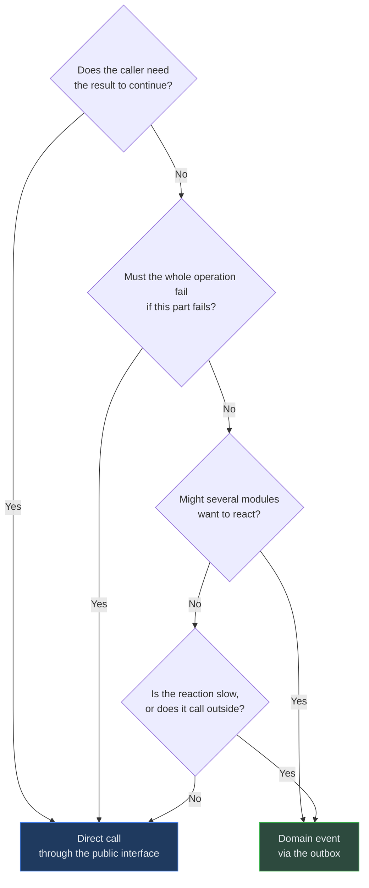

# Module Boundaries

> Audience: anyone adding a domain module or connecting two existing ones.
> Date: 2026-07-28.

[Dependency rules](DEPENDENCY_RULES.md) govern _layers_ and are enforced by lint. This
document governs _modules within a layer_ — the part lint cannot check, and therefore the
part that actually decays.

---

## Why this matters more than it appears to

A modular monolith with no internal boundaries is just a monolith. The boundaries are the
entire justification for choosing it over microservices: they give transactional simplicity
_and_ keep extraction possible.

They erode in a specific, predictable way, and never through a decision anybody would defend
in review:

1. A module needs one field from another module's table. A join is added — it is one query.
2. Another module does the same. Now two modules depend on a third module's column names.
3. A schema change now breaks three modules. The team stops changing schemas.
4. The boundary exists only in documentation.

The rules below exist to interrupt that sequence at step 1.

---

## What a module owns

Each domain module owns:

- **Its tables.** Nobody else reads or writes them directly.
- **Its rules.** Its invariants are enforced inside it, not by its callers.
- **Its public interface.** A narrow set of operations and types.
- **Its events.** Facts it publishes about things that happened.

Each domain module does **not** own:

- another module's tables, at any distance;
- another module's invariants;
- shared infrastructure (`outbox`, `idempotency_keys`) — that belongs to the platform.

---

## The four ways modules may communicate

### 1. A direct call through a public interface — when you need the result

```ts
// Marketplace needs to know whether the seller owns the creature.
const owns = await ownedCreatures.isOwnedBy(creatureId, sellerId);
```

Use when: the caller needs an answer to proceed, and the operation belongs in the same
transaction.

### 2. A domain event — when you do not need the result

```ts
// The sale is complete. Notifications, quests and analytics all care; none blocks the sale.
await events.publish(marketplaceListingSold({ listingId, buyerId, sellerId, price }));
```

Use when: something else _may_ want to react, and the sale must succeed whether or not it
does. Published to the outbox inside the transaction. See
[event architecture](EVENT_ARCHITECTURE.md).

### 3. An interface the caller declares and the other module implements

Use when a low-level module must notify a higher-level one without depending on it — the
same inversion the domain uses for repositories.

### 4. Shared kernel types

Ids, `Money`, timestamps, `Result`. Deliberately tiny. See
[shared kernel](../domains/SHARED_KERNEL.md).

---

## Forbidden

**A cross-module database join.** If `marketplace` needs creature data, it asks the
`owned-creatures` module. It does not `JOIN owned_creatures`.

**Writing another module's tables.** Ever. Including "just this once, for a migration".

**Importing another module's internals.** Only its public interface.

**A circular dependency between modules.** If A needs B and B needs A, one of three things
is true: they are one module; a third module is missing; or one direction should be an event.

**Sharing a repository across modules.** A repository belongs to the module that owns the
data.

---

## Event or direct call? A decision procedure



The mistake to avoid is using an event because it feels decoupled, when the caller actually
needs the result. That turns a compile error into a silent runtime gap.

---

## Sizing a module

**Too small** if it has no invariants of its own and always changes alongside another. Merge
it.

**Too large** if it has several unrelated reasons to change, its interface has dozens of
unrelated operations, or two people can never work in it without conflicting. Split it.

**About right** if it owns a coherent set of data and rules, has an interface a newcomer can
read in one sitting, and can be described in one sentence without "and".

---

## The extraction test

A module is boundary-clean if you could plausibly extract it into a service:

- [ ] It owns its tables; nothing else reads them directly.
- [ ] Its interface is explicit and narrow.
- [ ] Callers depend on the interface, not on internals.
- [ ] It publishes events rather than calling consumers.
- [ ] Its invariants are enforced inside it.
- [ ] It has no circular dependency with another module.
- [ ] Its tests do not need another module's database tables.

**Run this test regularly. Do not act on it.** Extraction is not a goal — most modules
should never be extracted, and doing so trades transactional simplicity for a distributed
system. The test exists because a module that _could_ be extracted is a module with a real
boundary, and that is worth having on its own.

---

## Bootstrap status

No domain module exists. The API contains `health/` and `system/` only, and both are
platform concerns.

The [domain map](../domains/DOMAIN_MAP.md) describes the proposed modules and their
boundaries. They are designed, not built, and the next phase is to specify them properly
before any of them is implemented. See [backlog](../tasks/BACKLOG.md).

Related: [Dependency rules](DEPENDENCY_RULES.md) · [Domain map](../domains/DOMAIN_MAP.md) ·
[Event architecture](EVENT_ARCHITECTURE.md)
