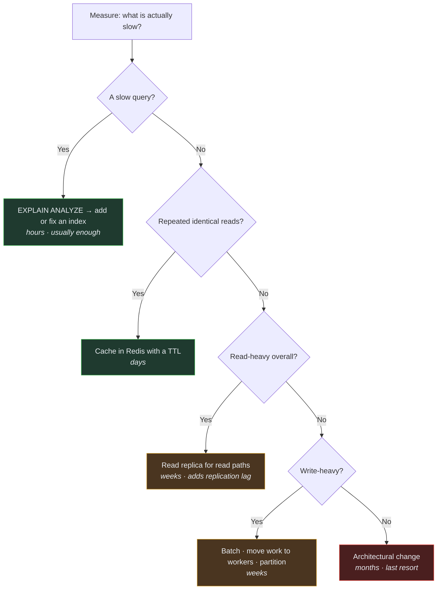

# Scaling Strategy

> Audience: whoever is looking at a graph that is going the wrong way. Date: 2026-07-28.
> **The system has zero users. Nothing here is urgent. It exists so the response is
> considered rather than improvised.**

---

## The rule

**Measure, then act.** Do not add caching, replicas, indexes or fan-out because something
might be slow. Add them when a measurement says so, and remove them when it no longer does.

The exception is design-level choices that are expensive to reverse — cursor pagination,
integer money, the outbox, UUIDv7 keys. Those are decided up front precisely because
retrofitting them means a migration.

---

## What scales easily, and what does not

| Component       | Scaling                                         | Difficulty                                   |
| --------------- | ----------------------------------------------- | -------------------------------------------- |
| **API**         | Horizontal replicas                             | **Easy** — stateless by design               |
| **Workers**     | More replicas, more queues                      | **Easy** — once the relay claims rows safely |
| **Web / Admin** | Replicas + CDN                                  | **Easy**                                     |
| **Redis**       | Vertical, then clustering                       | Moderate                                     |
| **PostgreSQL**  | Vertical, then read replicas, then partitioning | **Hard** ← the real constraint               |

**The database is the bottleneck**, as it is in almost every system of this shape. Everything
else is a matter of running more copies.

---

## Order of response

Cheapest and least disruptive first. Do not skip ahead.

---

## Thresholds

Rough shapes, not commitments. Real numbers replace them once real load exists.

| Signal               | Watch             | Act                |
| -------------------- | ----------------- | ------------------ |
| API p99 latency      | > 300 ms          | > 1 s              |
| Database CPU         | > 50% sustained   | > 70% sustained    |
| Database connections | > 60% of pool     | > 80%              |
| Redis memory         | > 60%             | > 80%              |
| Queue depth          | growing for 5 min | growing for 30 min |
| Outbox lag           | > 10 s            | > 60 s             |
| Error rate           | > 0.1%            | > 1%               |

---

## Known future hot spots

Predicted from the domain shape, not from measurement. Recorded so the first person to hit
one is not surprised.

**Marketplace listing search.** The most-queried, most-filtered, most-sorted surface in the
game, over a table that changes constantly. Response: composite indexes matched to the actual
filter combinations; then a short-TTL cache on the popular queries; then a dedicated read
path. Not a search engine — see [non-goals](../product/NON_GOALS.md).

**Ledger balance computation.** Summing entries is correct but grows linearly with a
player's history. Response: a cached balance column that is _derived from and reconcilable
against_ the entries. The ledger stays the source of truth; the cache is an optimisation that
can be rebuilt.

**Battle resolution CPU.** Deterministic and pure, so it parallelises perfectly. If it
becomes hot, move it to workers — the engine has no I/O, so this is a scheduling change, not
a rewrite. This is one concrete payoff of the purity constraint.

**Expedition and listing expiry sweeps.** A naive "scan everything every minute" degrades as
the table grows. Response: index on the expiry timestamp, process in batches, and schedule
per-item rather than sweeping.

**The outbox relay.** A single consumer is a throughput ceiling. Response: `SELECT … FOR
UPDATE SKIP LOCKED` so multiple relays can claim disjoint rows safely. Design for it; do not
build it until one relay is measurably insufficient.

---

## Scaling the team

Worth stating, because it is the constraint that actually bites first on a small project.

The monorepo, the strict boundaries and the shared contracts exist partly so that more than
one person can work without collisions. If two people cannot work in the same module without
conflicting, that module is too large — see
[module boundaries](MODULE_BOUNDARIES.md#sizing-a-module).

---

## When to extract a service

Only when **all** of these hold:

- [ ] A measured constraint requires it — not a prediction.
- [ ] The module's boundary has held in practice for a meaningful period.
- [ ] It does not need to share a transaction with anything it would be split from.
- [ ] The operational cost is understood and someone has agreed to carry it.
- [ ] An ADR records the decision and its consequences.

Most modules will never qualify, and that is the intended outcome. The extraction _test_ is
run regularly; the extraction itself is not.

Related: [Architecture overview](ARCHITECTURE_OVERVIEW.md) · [Cost strategy](COST_STRATEGY.md) ·
[Data architecture](DATA_ARCHITECTURE.md)
