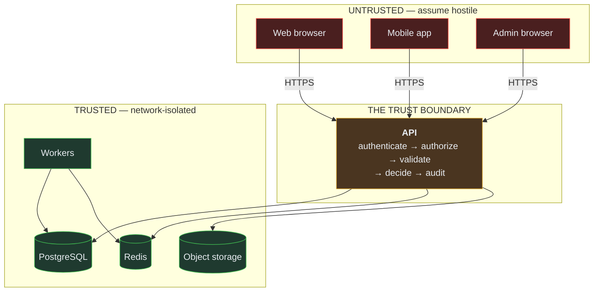

# Security Architecture

> Audience: everyone. Date: 2026-07-28.
> Binding rules: [security rules](../constitution/SECURITY_RULES.md).
> Threats and mitigations: [threat model](../security/THREAT_MODEL.md).

---

## Trust boundaries

**There is exactly one trust boundary, and it is the API.**

Everything on the left is untrusted — including our own applications. A mobile binary can be
unpacked, its traffic intercepted, its requests replayed and modified. "It came from our app"
is not a security property.

Everything on the right is network-isolated and reachable only from server processes. Every
infrastructure port binds to `127.0.0.1` locally.

---

## Client versus server authority

| Decision              | Who decides | If the client decided instead       |
| --------------------- | ----------- | ----------------------------------- |
| Battle outcome        | **Server**  | Every player wins every battle      |
| Reward contents       | **Server**  | Every player claims the rarest drop |
| Currency balance      | **Server**  | Infinite currency                   |
| Inventory contents    | **Server**  | Infinite items                      |
| Ownership             | **Server**  | Take anyone's creature              |
| Marketplace price     | **Server**  | Buy anything for 0                  |
| Time-gated completion | **Server**  | Every expedition finishes instantly |
| Which tab is open     | Client      | Nothing                             |
| Animation timing      | Client      | Nothing                             |

The client may _predict_ to feel responsive — showing a battle animation, greying out an
unaffordable item — but the server's answer always wins, and disagreement is resolved in the
server's favour without argument.

---

## Authentication

Bearer JWT access tokens (short-lived, ~15 minutes) plus refresh tokens (long-lived,
revocable, rotated on use).

| Client      | Refresh token storage                                       | Why                                                      |
| ----------- | ----------------------------------------------------------- | -------------------------------------------------------- |
| Web / Admin | `httpOnly`, `Secure`, `SameSite` cookie                     | Unreachable from JavaScript, so XSS cannot exfiltrate it |
| Mobile      | Keychain (iOS) / Keystore (Android) via `expo-secure-store` | OS-level protection, not plain storage                   |

The mobile locale preference already uses SecureStore, even though a language is not
sensitive — establishing the pattern before there are three call sites using plain storage.

Access tokens are short-lived so a leaked one has a small window. Refresh tokens are
revocable so a compromised session can be ended server-side — which is impossible with
long-lived stateless tokens alone.

See [authentication model](../security/AUTHENTICATION_MODEL.md).

---

## Authorization

**Server-side, per operation, deny-by-default.**

Three checks, in order, on every protected request:

1. **Authenticated?** Valid, unexpired, unrevoked token.
2. **Permitted?** Does this actor's role allow this operation?
3. **Entitled?** Does this actor own or have access to this specific resource?

Step 3 is the one that gets forgotten. Receiving `creatureId` in a request body does not mean
the requester owns that creature.

A failure at step 2 or 3 on a resource lookup returns **404, not 403** — distinguishing them
lets an attacker enumerate other players' identifiers.

See [authorization model](../security/AUTHORIZATION_MODEL.md).

---

## Input validation

Every value crossing the boundary is parsed against a schema before use. Parse, don't
validate — a function that takes `unknown` and returns a typed value, never one that asserts
about an already-typed argument.

Bodies are capped at 1 MiB. Free-text fields are trimmed and length-bounded. Display names
are Unicode-aware — a filter that only allows `[a-z]` would reject most Turkish names, which
is both a bug and a product failure.

**Rejected input is never echoed back.** A validation error containing the payload puts
passwords and tokens into logs and error trackers.

---

## Secrets

**At rest.** Never committed. `.env` is git-ignored; `.env.example` contains placeholders
only. Certificates, keystores and service-account files are git-ignored by pattern.

**In configuration.** Validated at process start. A missing or malformed secret crashes the
process — it never falls back to a default, because a default JWT secret is a vulnerability
that will ship. Production additionally rejects the example placeholder, wildcard CORS and
an unencrypted database connection.

**In logs.** Redacted at the logger by key pattern, **deny-by-default** — so a newly added
secret is protected before anyone remembers to add it to a list. Connection strings are
masked to keep the host readable and the password hidden.

**In client bundles.** Nothing secret goes behind `NEXT_PUBLIC_` or `EXPO_PUBLIC_`. Those
values are inlined into bundles a player can read. A mobile app cannot hold a secret at all.

See [secret management](../security/SECRET_MANAGEMENT.md).

---

## Transport hardening

**API.** `@fastify/helmet` with a restrictive CSP — the API returns JSON, never HTML, so
`default-src 'none'` costs nothing and closes off the class of attacks that rely on a browser
rendering an API response. CORS is an explicit origin list, never a wildcard; production
configuration rejects `*`.

**Web.** `nosniff`, `X-Frame-Options: DENY`, `strict-origin-when-cross-origin`, a
permissions policy denying camera, microphone and geolocation.

**Admin, additionally.** `frame-ancestors 'none'` — an admin console must never be
embeddable, or a clickjacking page can drive it with an administrator's session. Plus
`no-store` and `noindex`.

---

## Economy and ownership

The highest-value target in the system. Every currency, inventory or ownership change is
transactional, idempotent, audited and tested. Balances are derived from an append-only
ledger, never assigned.

Idempotency is enforced by a **database unique constraint**, not an application check — a
check-then-insert is a race, and the race is a double spend.

Full rules: [economy integrity rules](../constitution/ECONOMY_INTEGRITY_RULES.md).

---

## Administrative privilege

A compromised admin account can mint currency and alter ownership, so it is treated as the
most sensitive identity in the system:

- separate application, separate authentication, its own role model;
- **every action audited** with a named actor — and separately when acting on a player's
  behalf, so an admin action is never attributed to the player;
- economy-affecting actions require a recorded justification;
- least privilege by role (`SUPPORT`, `MODERATOR`, `ECONOMY`, `SUPER_ADMIN`);
- high-risk actions require re-authentication.

**Today the admin console grants nothing.** `getAdminSession()` returns `null`, so
`requireAdmin` denies every role, and there is a test asserting exactly that. A placeholder
login that "works" is strictly more dangerous than no login, because it gets forgotten and
ships.

---

## File uploads

Not implemented. Requirements, recorded before the first one is built:

- validate by **content**, not extension or client-supplied MIME type;
- hard size limits, enforced at the edge;
- store outside the web root, in object storage, with generated names;
- serve from a domain that carries **no session cookies**, so a malicious upload cannot
  reach one;
- never render user content as HTML;
- scan where practical.

---

## Supply chain

Exact pinned versions, committed lockfile, `--frozen-lockfile` in CI. Install scripts are
blocked by default (`onlyBuiltDependencies`); allowing one is a reviewed decision.

A new dependency needs a justification in the pull request. See
[supply chain security](../security/SUPPLY_CHAIN_SECURITY.md).

---

## Development-environment safety

- Local infrastructure binds to `127.0.0.1` only — nothing is reachable from the network.
- Local credentials are well-known development values, useless anywhere else.
- Mailpit captures all outbound mail, so a notification bug cannot email a real person.
- `pnpm infra:reset` requires `--yes` before destroying volumes.
- `COLLECTION_WAR_ENV` exists separately from `NODE_ENV` so the application can tell which
  environment's data it is touching — and refuse.
- `db:seed` refuses to run against production.

---

## Known gaps

Stated plainly rather than implied by absence:

| Gap                             | Status                                                   |
| ------------------------------- | -------------------------------------------------------- |
| Authentication                  | **Not implemented.** No login exists in any application. |
| Authorization enforcement       | Structure exists; nothing to enforce yet.                |
| Rate limiting                   | **Not implemented.** Designed, not built.                |
| Content Security Policy for web | Deliberately deferred — see `next.config.mjs`            |
| Automated dependency scanning   | CI workflow exists; not yet exercised                    |
| Penetration testing             | Not performed                                            |
| Threat model per domain         | Only the platform-level model exists                     |

All tracked in [risks](../status/RISKS.md) and [deferred work](../status/DEFERRED_WORK.md).

Related: [Threat model](../security/THREAT_MODEL.md) ·
[Security review checklist](../security/SECURITY_REVIEW_CHECKLIST.md)
