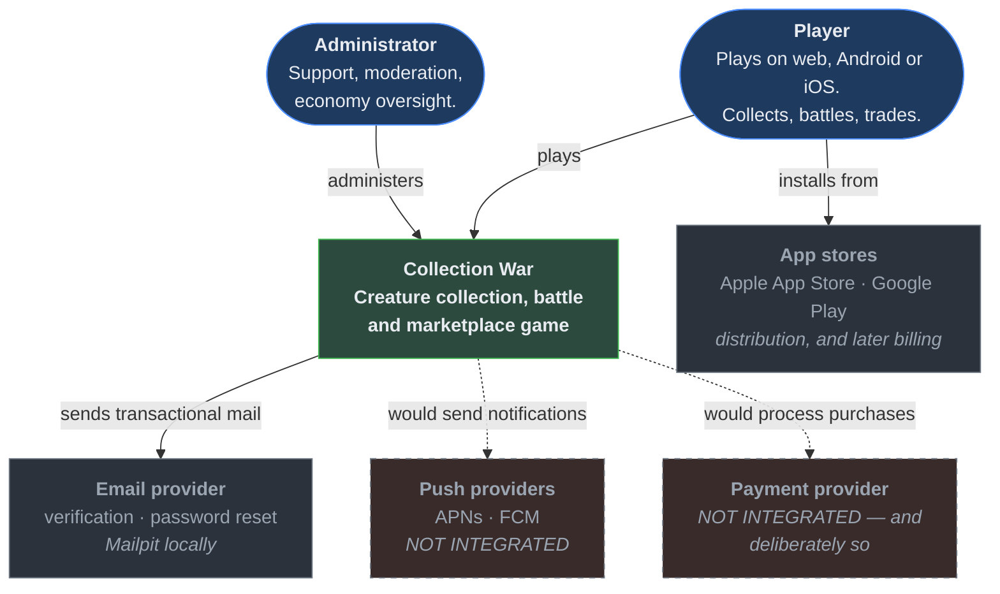

# System Context (C4 Level 1)

> Audience: anyone orienting themselves. Date: 2026-07-28.
> The outermost view: who uses Collection War, and what it depends on.

---

Dashed = designed for, not integrated.

---

## Actors

### Player

The primary user. Plays on one of three clients, often on more than one, expecting the same
account and the same state everywhere.

**Trust level: none.** Not a judgement about people — a statement about the channel. A
client binary can be unpacked, its traffic intercepted and its requests replayed. Every
request is authenticated and authorised on its own merits, and no client-supplied value is
trusted. See [security rules](../constitution/SECURITY_RULES.md).

### Administrator

Support, moderation and economy oversight through a separate application.

**Trust level: authenticated, but still not trusted with everything.** Administrative
privilege is the highest-value target in the system: a compromised admin account can mint
currency and alter ownership. Therefore every admin action is role-gated, audited with a
named actor, and — where it affects the economy — requires a recorded justification. See
[authorization model](../security/AUTHORIZATION_MODEL.md).

---

## External dependencies

### Integrated

**Email provider.** Verification, password reset, security notices. Locally this is
**Mailpit**, which captures everything on the machine — so a bug in notification code cannot
email a real person during development.

**App stores.** Distribution for iOS and Android. Their review policies are a real
constraint on the product, particularly around randomised rewards and anything resembling
gambling. Later, also the billing channel — which is one reason
[real-money withdrawal stays disabled](../constitution/ECONOMY_INTEGRITY_RULES.md#e9-real-money-withdrawal-stays-disabled).

### Designed for, not integrated

**Push providers (APNs, FCM).** Requires developer accounts and credentials. The
notification domain is designed so that adding a channel is a delivery adapter, not a
redesign.

**Payment provider.** Requires legal review, KYC/AML obligations and tax handling. Not
integrated, and its absence is a decision rather than a gap. See
[ADR-0023](../adr/ADR-0023-no-real-money-withdrawal.md).

### Deliberately absent

No analytics SaaS, no error-reporting SaaS, no CDN, no feature-flag service, no blockchain.
Each would add cost, a data-processing relationship, and a supply-chain surface, in exchange
for value that does not exist before there are players. See
[cost strategy](COST_STRATEGY.md) and [non-goals](../product/NON_GOALS.md).

---

## What crosses the boundary

| Direction       | Data                                                | Protection                                                                                         |
| --------------- | --------------------------------------------------- | -------------------------------------------------------------------------------------------------- |
| Player → system | Credentials, game actions, marketplace operations   | TLS · schema-validated · authenticated · authorised · rate-limited · idempotent for economy writes |
| System → player | Game state, battle results, listings, notifications | TLS · authorization-filtered · no internal detail in errors                                        |
| Admin → system  | Support and moderation actions                      | TLS · role-gated · audited with actor and justification                                            |
| System → email  | Address, transactional content                      | TLS · minimal personal data · no secrets in message bodies                                         |

---

Related: [Container architecture](CONTAINER_ARCHITECTURE.md) ·
[Security architecture](SECURITY_ARCHITECTURE.md) · [Threat model](../security/THREAT_MODEL.md)
