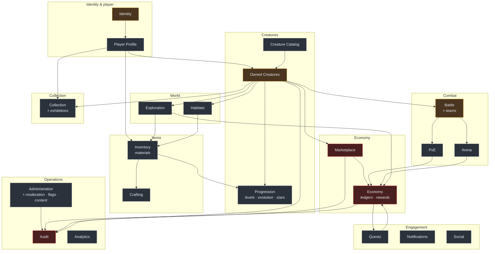

# Domain Map

> **Status: PROPOSED.** Date: 2026-07-28. **No domain is implemented.**
> Audience: anyone designing or building a feature.

This is the proposed decomposition of Collection War into bounded contexts. It exists so
that the first feature has a home and the tenth feature does not have to invent one.

**Nothing here is built.** The next phase specifies these properly before any is
implemented — see [CW-0002](../tasks/BACKLOG.md).

---

## The map

Red = highest integrity requirements. Amber = core to the game loop.

---

## The thirty domains, and where each lives

The prompt-level domain list contains thirty concerns. Several are naturally one bounded
context — separating them would create modules that always change together, which is the
definition of a boundary in the wrong place. The mapping:

| #   | Domain concern        | Documented in                                                                                 | Why grouped                                                       |
| --- | --------------------- | --------------------------------------------------------------------------------------------- | ----------------------------------------------------------------- |
| 1   | Identity              | [`identity/`](identity/)                                                                      |                                                                   |
| 2   | Player Profile        | [`player-profile/`](player-profile/)                                                          |                                                                   |
| 3   | Creature Catalog      | [`creature-catalog/`](creature-catalog/)                                                      |                                                                   |
| 4   | Owned Creatures       | [`owned-creatures/`](owned-creatures/)                                                        |                                                                   |
| 5   | Creature Progression  | [`progression/`](progression/)                                                                |                                                                   |
| 6   | Evolution             | [`progression/`](progression/)                                                                | Same aggregate, same invariants, always change together           |
| 7   | Star Development      | [`progression/`](progression/)                                                                | Same                                                              |
| 8   | Materials & Inventory | [`inventory/`](inventory/)                                                                    |                                                                   |
| 9   | Crafting              | [`crafting/`](crafting/)                                                                      | Separate: it _consumes_ inventory, it does not own it             |
| 10  | Teams                 | [`battle/`](battle/)                                                                          | A team exists only to enter a battle                              |
| 11  | Battle                | [`battle/`](battle/)                                                                          |                                                                   |
| 12  | PvE                   | [`pve/`](pve/)                                                                                |                                                                   |
| 13  | Arena                 | [`arena/`](arena/)                                                                            |                                                                   |
| 14  | Exploration           | [`exploration/`](exploration/)                                                                |                                                                   |
| 15  | Habitats              | [`habitats/`](habitats/)                                                                      |                                                                   |
| 16  | Collection Catalog    | [`collection/`](collection/)                                                                  |                                                                   |
| 17  | Exhibitions           | [`collection/`](collection/)                                                                  | Presentation of a collection                                      |
| 18  | Marketplace           | [`marketplace/`](marketplace/)                                                                |                                                                   |
| 19  | Economy & Ledgers     | [`economy/`](economy/)                                                                        |                                                                   |
| 20  | Quests                | [`quests/`](quests/)                                                                          |                                                                   |
| 21  | Rewards               | [`economy/`](economy/)                                                                        | A reward IS a ledger movement; splitting them splits an invariant |
| 22  | Notifications         | [`notifications/`](notifications/)                                                            |                                                                   |
| 23  | Friends & Social      | [`social/`](social/)                                                                          |                                                                   |
| 24  | Administration        | [`administration/`](administration/)                                                          |                                                                   |
| 25  | Moderation            | [`administration/`](administration/)                                                          | Same actors, same audit, same privilege model                     |
| 26  | Audit                 | [`audit/`](audit/)                                                                            | Separate: it must not depend on what it audits                    |
| 27  | Analytics             | [`analytics/`](analytics/)                                                                    |                                                                   |
| 28  | Feature Flags         | [`administration/`](administration/)                                                          | An operational control surface                                    |
| 29  | Localization          | **Cross-cutting** — [localization architecture](../architecture/LOCALIZATION_ARCHITECTURE.md) | Not a bounded context; every domain uses it                       |
| 30  | Content Management    | [`administration/`](administration/)                                                          | Authoring and versioning of content                               |

---

## Integrity tiers

Not every domain deserves the same rigour. Three tiers, and they determine how much process a
change requires:

### Tier 1 — Critical

`economy` · `marketplace` · `identity` · `audit` · `owned-creatures`

A bug loses real value or real trust. Requires: transactions, idempotency, audit records,
executable invariants, exhaustive tests, security review, and an ADR for any structural
change.

### Tier 2 — Core

`battle` · `inventory` · `progression` · `crafting` · `quests` · `administration`

A bug is visible and annoying but recoverable. Requires: transactions where state changes,
thorough tests, and review.

### Tier 3 — Supporting

`player-profile` · `creature-catalog` · `collection` · `pve` · `arena` · `exploration` ·
`habitats` · `notifications` · `social` · `analytics`

A bug is inconvenient. Requires: ordinary care.

---

## Cross-cutting concerns

These are **not** domains. They are used by every domain, and modelling them as bounded
contexts would give each one a dependency on all the others.

| Concern       | Where                    | Note                                  |
| ------------- | ------------------------ | ------------------------------------- |
| Localization  | `packages/localization`  | Every domain, every client            |
| Observability | `packages/observability` | Every server process                  |
| Configuration | `packages/configuration` | Every process, at startup             |
| Validation    | `packages/validation`    | Every boundary                        |
| Shared kernel | `packages/shared-types`  | [Deliberately tiny](SHARED_KERNEL.md) |
| Idempotency   | `domain` + `database`    | Every economy write                   |
| Outbox        | `domain` + `database`    | Every domain that publishes an event  |

---

## Reading a domain document

Each one answers eleven questions, in this order:

1. **Purpose** — one sentence.
2. **Responsibilities** — what it decides.
3. **Owned data** — its tables. Nobody else touches them.
4. **Public interface** — how others use it.
5. **Incoming dependencies** — who needs it.
6. **Outgoing dependencies** — what it needs.
7. **Domain events** — the facts it publishes.
8. **Security concerns** — what an attacker would want here.
9. **Economy concerns** — how it can create or destroy value.
10. **Expected scaling pressure** — where it will hurt first.
11. **What it must never do** — the boundary, stated as prohibitions.

Question 11 is the most useful one. A boundary described only as capabilities always grows;
one described as prohibitions is reviewable.

Related: [Domain index](README.md) · [Shared kernel](SHARED_KERNEL.md) ·
[Module boundaries](../architecture/MODULE_BOUNDARIES.md)
