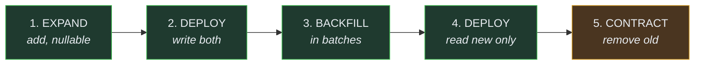

# Runbook: Migrations

> Audience: anyone changing the schema. Date: 2026-07-28.
> **Read the whole thing before your first production migration.** A bad migration is one of
> the few things in this system that cannot be rolled back.

---

## The workflow

```bash
# 1. Edit the TypeScript schema
$EDITOR packages/database/src/schema/<table>.ts

# 2. Generate SQL
pnpm db:generate

# 3. READ THE GENERATED SQL. Every line.
$EDITOR packages/database/drizzle/<timestamp>_<name>.sql

# 4. Apply locally
pnpm db:migrate

# 5. Verify
pnpm test:integration

# 6. Commit the schema change AND the migration together
```

**Step 3 is not optional.** The generator is good, not infallible, and the one thing it
cannot know is whether a rename is a rename or a drop-and-add. Getting that wrong silently
deletes a column of production data.

---

## Rules

**Migrations are generated, reviewed, committed and applied in order.** Never applied from a
running application.

**`drizzle-kit push` is not used.** It diffs a live database against the schema and applies
the difference with no migration file — so the change is neither reviewable nor reproducible
on another environment. It is deliberately not wired to any script.

**Never edit an applied migration.** Write a new one. Editing one means environments that
already ran it are permanently different from environments that have not.

**One logical change per migration.** A migration that does four things cannot be reasoned
about, and a failure halfway through leaves a state nobody planned for.

---

## Safety checklist

Before applying anything to a database with real data:

- [ ] Reviewed the generated SQL line by line
- [ ] Applied and tested locally
- [ ] **No table rewrite on a large table.** Adding a `NOT NULL` column with a default can be
      one, depending on the PostgreSQL version and the default
- [ ] **No long-held `ACCESS EXCLUSIVE` lock.** `ALTER TABLE` takes one; on a busy table that
      is an outage
- [ ] `CREATE INDEX CONCURRENTLY` for any index on a large table
- [ ] **The previous application version still works against this schema**
- [ ] A backup exists, and it has been restored at least once so you know it works

---

## Expand / contract

The pattern for any breaking change. It exists because **a migration and a deploy are not
atomic** — for a period, the old code and the new schema coexist.



**Steps 1 and 5 are separate releases**, sometimes days apart.

A migration that drops a column in the same release as the code that stopped using it
**cannot be rolled back** — roll back the code, and the old version comes back looking for a
column that no longer exists.

### Renaming a column

Never `ALTER TABLE ... RENAME COLUMN` in one step on a live system.

1. Add the new column.
2. Deploy code that writes both and reads the old.
3. Backfill.
4. Deploy code that reads the new.
5. Drop the old, in a later release.

### Backfilling

In batches, with a delay. A single `UPDATE` over millions of rows holds locks, bloats the
table and can exhaust WAL.

```sql
UPDATE owned_creatures SET new_column = old_column
WHERE new_column IS NULL AND id IN (
  SELECT id FROM owned_creatures WHERE new_column IS NULL LIMIT 1000
);
```

Repeat until zero rows are affected.

---

## Rollback

**Application:** redeploy the previous image. Fast and safe — the API is stateless.

**Database:** in general, you cannot. Which is exactly why expand/contract exists: every
intermediate state must be one the previous version can also run against.

If a migration must be reversed, the honest answer is usually a _new forward migration_ that
restores the previous shape — not an "undo".

**Restoring from backup loses every write since the backup.** For an economy, that means
players losing purchases and trades they have already seen. It is a last resort with real
consequences, not a rollback button.

---

## If a migration fails halfway

1. **Do not retry blindly.** Find out what actually applied.
2. Inspect the state: `\d+ <table>` in `psql`.
3. Check the migration tracking table.
4. If the migration was transactional, PostgreSQL rolled it back — good.
5. If it was not (`CREATE INDEX CONCURRENTLY` cannot be), reconcile manually and carefully.
6. Write down what happened. That is [incident response](INCIDENT_RESPONSE.md).

---

## Current state

**No migrations exist.** The schema defines two platform tables and no migration has been
generated, because no database has been run — Docker was unavailable during the bootstrap.

**The full generate → review → apply cycle has therefore never been exercised.** It must be,
before it matters. See [risks](../status/RISKS.md).

Related: [Database](DATABASE.md) · [Backups](BACKUPS.md) ·
[Data architecture](../architecture/DATA_ARCHITECTURE.md)
