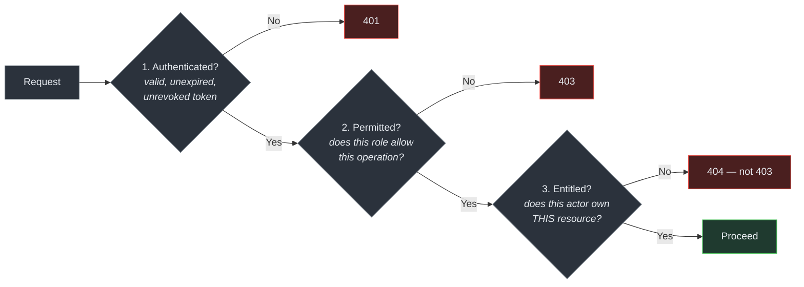

# Authorization Model

> Audience: anyone adding an endpoint or an admin capability. Date: 2026-07-28.
> **Status: DESIGNED, NOT IMPLEMENTED.**

---

## The three checks

Every protected request passes three checks, in order:

**Check 3 is the one that gets forgotten.**

Receiving `creatureId` in a request body does not mean the requester owns that creature.
Every operation on a specific resource re-verifies entitlement — server-side, in the same
transaction as the change where it matters.

### Why check 3 returns 404, not 403

A 403 confirms the resource exists. Iterate identifiers, collect the 403s, and you have
enumerated other players' creatures, listings and accounts.

The response is identical whether the resource does not exist or is not yours.

---

## Principles

**Deny by default.** A new endpoint is unreachable until it explicitly declares who may call
it. The failure mode of "allow unless denied" is a forgotten rule and an open endpoint; the
failure mode of "deny unless allowed" is a broken feature someone notices immediately.

**Server-side, always.** Hiding a control in the UI is not access control. It is a courtesy
to honest users.

**Per operation, not per screen.** The same resource can be readable and not writable, or
writable by its owner and by an administrator under different conditions.

**Ownership is verified at the point of change**, not cached from an earlier check. A creature
can be sold between the two.

---

## Player authorization

Players have no roles. A player may act on **their own** resources and read a limited public
view of others'.

| Resource                | Owner               | Another player | Anonymous |
| ----------------------- | ------------------- | -------------- | --------- |
| Own profile             | read/write          | —              | —         |
| Public profile          | read                | read           | read      |
| Own creatures           | read/write          | —              | —         |
| Another's creatures     | —                   | **404**        | **404**   |
| Own inventory / balance | read                | —              | —         |
| Marketplace listings    | read all, write own | read all       | read all  |
| Own battle history      | read                | —              | —         |

Marketplace listings are public by nature — that is what a marketplace is. The **listing** is
public; the seller's inventory, balance and account are not.

---

## Administrator roles

| Role          | May                                                        | May not                          |
| ------------- | ---------------------------------------------------------- | -------------------------------- |
| `SUPPORT`     | Look up a player, view state and audit, respond to reports | Adjust currency, issue sanctions |
| `MODERATOR`   | The above, plus sanctions and content moderation           | Adjust currency                  |
| `ECONOMY`     | The above, plus currency and inventory adjustment          | Manage administrators            |
| `SUPER_ADMIN` | Everything, including administrator management             | —                                |

**Currency adjustment requires `ECONOMY`, not merely "admin".** Separating it is the point of
having roles at all — most support work needs no ability to create value.

### Rules for administrative action

- **Every action is audited**, with the actor named.
- **Acting on a player's behalf is recorded separately** (`Actor.onBehalfOf`), so an admin
  action is never attributed to the player.
- **A justification is required** for anything economy-affecting, and stored.
- **Re-authentication for high-risk actions.**
- **Administrative changes obey the same economy rules as player actions**: transactional,
  idempotent, ledger-recorded. An admin currency grant is a ledger entry from a system
  faucet, not a balance edit. **There is no privileged path around the invariants.**

---

## Where the check goes

Authorization is an **application-layer** concern.

- **Transport** knows _who_ the actor is, from the token.
- **Application services** decide _whether_ they may.
- **Domain logic** assumes the decision was already made and enforces business invariants.

Putting authorization in the controller means the worker process — which runs the same
operations — has none. Putting it in the domain means the domain needs to know about roles,
sessions and HTTP.

---

## Testing

Every protected operation needs these, and they are not optional:

- [ ] Unauthenticated → 401
- [ ] Authenticated, wrong role → 403
- [ ] Authenticated, right role, **not the owner** → **404**
- [ ] Authenticated, right role, owner → success
- [ ] Ownership re-verified **inside** the transaction, not before it

The third case is the one that catches real bugs.

---

## Current state

Nothing enforced, because there is nothing to enforce and nobody to authenticate.

What exists: `apps/admin/src/lib/auth.ts` defines the roles and a `requireAdmin` guard that
**denies every role**, with tests asserting that every role is denied and that it fails
closed.

Those tests exist to make adding a placeholder session fail the build. A placeholder admin
session is the single most dangerous shortcut available in this codebase — it works, gets
forgotten, and ships.

Related: [Authentication model](AUTHENTICATION_MODEL.md) ·
[Administration domain](../domains/administration/) · [Audit domain](../domains/audit/)
