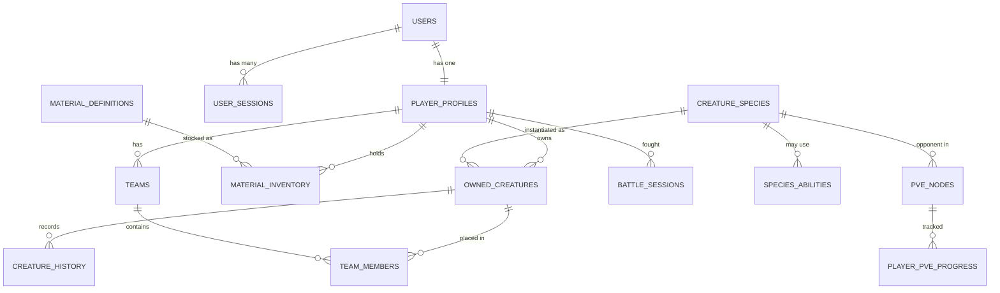

# Data Model: First playable loop

- **Status:** Implemented
- **Date:** 2026-07-28
- **Migration:** `packages/database/drizzle/0000_game_schema.sql`
- **Owning modules:** see [GAME_STATE_OWNERSHIP.md](../../architecture/GAME_STATE_OWNERSHIP.md)

Conventions — UUIDv7 keys, `timestamptz` in UTC, soft deletion, optimistic concurrency — are
in [DATA_ARCHITECTURE.md](../../architecture/DATA_ARCHITECTURE.md). Only what is specific to
this slice is here.

---

## Entity relationships



---

## The constraints that carry correctness

These are **not** performance indexes. Dropping one reintroduces a specific exploit, so each
is listed with the exploit it prevents.

| Constraint                        | Table                                                   | Prevents                                                                               |
| --------------------------------- | ------------------------------------------------------- | -------------------------------------------------------------------------------------- |
| `CHECK (quantity >= 0)`           | `material_inventory`                                    | A negative material stack — value created by over-consuming                            |
| `UNIQUE (key, scope)`             | `idempotency_keys`                                      | **Double grants.** A retried battle awarding rewards twice                             |
| `UNIQUE (email)`                  | `users`                                                 | Two accounts on one address under concurrent registration                              |
| `UNIQUE (refresh_token_hash)`     | `user_sessions`                                         | Token collision                                                                        |
| `UNIQUE (team_id, slot)`          | `team_members`                                          | Two creatures in one slot                                                              |
| `UNIQUE (team_id, creature_id)`   | `team_members`                                          | **One creature filling every slot**                                                    |
| `UNIQUE (player_id, material_id)` | `material_inventory`                                    | Two stacks of one material, so a consume could miss one                                |
| `UNIQUE (slug, content_version)`  | `creature_species`, `material_definitions`, `pve_nodes` | Ambiguous content within a version, while still allowing the same slug across versions |
| `UNIQUE (player_id, node_id)`     | `player_pve_progress`                                   | Duplicate progress rows                                                                |

All nine are verified by `packages/database/src/schema.integration.test.ts` against real
PostgreSQL.

## Mutability

| Table                                                   | Mutability                | Why                                                                  |
| ------------------------------------------------------- | ------------------------- | -------------------------------------------------------------------- |
| `creature_history`                                      | **Append-only**           | Ownership and progression history must survive a transfer            |
| `inventory_transactions`                                | **Append-only**           | Every material is traceable to what produced it                      |
| `battle_sessions`                                       | **Immutable**             | A result must replay identically; an editable record is not evidence |
| `creature_species`, `material_definitions`, `pve_nodes` | **Immutable per version** | A March battle replays under March's numbers                         |
| `owned_creatures`                                       | Mutable + `version`       | Ordinary player state, protected by optimistic concurrency           |
| `player_profiles`                                       | Mutable + `version`       | Same                                                                 |

## Soft deletion

Only `owned_creatures` carries `deleted_at`, with a **partial index** on
`(player_id) WHERE deleted_at IS NULL` — the "list my creatures" path is the hot query, and a
partial index keeps only live rows in it.

## Ownership in the WHERE clause

Every mutating statement filters on `player_id`:

```sql
UPDATE owned_creatures
   SET level = $1, experience = $2, version = version + 1
 WHERE id = $3 AND player_id = $4 AND version = $5 AND deleted_at IS NULL;
```

Ownership is re-verified **in the write**, not checked earlier and trusted — a creature can be
sold between a check and a write. The `version` predicate makes a lost update impossible: zero
rows affected means someone else wrote first, and the caller gets `STALE_WRITE`.

## Growth curves as `jsonb`

`creature_species.growth` holds `{ base: Stats, perLevel: Stats }` rather than 18 columns. It
is read as a whole and never queried by component, and adding a stat later must not require a
migration touching every species row.

**Stats are never stored on `owned_creatures`.** They are derived from the growth curve and
the level, so they cannot drift from the content version — see
[GAME_ARCHITECTURE.md](../../architecture/GAME_ARCHITECTURE.md#stat-computation).

## Migration safety

The migration is **additive only** — it creates tables and indexes and alters nothing. It is
safe to apply while a previous version is running, because no previous version referenced any
of these tables.

The next migration will not have that luxury; see
[expand/contract](../../runbooks/MIGRATIONS.md#expand--contract).

## Retention

| Data                     | Retained                 | Reason                                                     |
| ------------------------ | ------------------------ | ---------------------------------------------------------- |
| `battle_sessions`        | Medium                   | Replay and support; the events log is the bulk of the size |
| `creature_history`       | Long                     | Dispute evidence, survives ownership change                |
| `inventory_transactions` | Long                     | Traceability                                               |
| `user_sessions`          | Until expiry, then swept |                                                            |
| `idempotency_keys`       | 24 hours                 | Long enough for a late retry; not forever                  |

## Open questions

1. `battle_sessions.events` is `jsonb` and grows with turn count. At volume this becomes the
   largest table; a retention or archival policy is needed before launch.
2. Experience currently lands on the first active team member only. Distributing it across a
   team is a design decision belonging with the 3v3 work.
