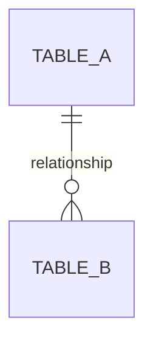

# Data Model: <Domain / Feature>

- **Status:** Draft | In review | Approved | Implemented
- **Date:** YYYY-MM-DD
- **Owning domain:**

> Conventions — UUIDv7 keys, `timestamptz` in UTC, soft deletion, optimistic concurrency —
> are in [data architecture](../../architecture/DATA_ARCHITECTURE.md). Specify what is
> specific here.

---

## Entity relationships



## Tables

### `<table_name>`

**Owned by:** `<domain>` · **Mutability:** mutable | append-only | immutable
**Soft-deletable:** yes | no · **Versioned:** yes | no

| Column       | Type          | Null | Default | Notes            |
| ------------ | ------------- | ---- | ------- | ---------------- |
| `id`         | `uuid`        | no   |         | PK, UUIDv7       |
|              |               |      |         |                  |
| `created_at` | `timestamptz` | no   | `now()` | Server-generated |
| `updated_at` | `timestamptz` | no   | `now()` | Server-generated |

#### Constraints

| Constraint | Type | Purpose |
| ---------- | ---- | ------- |

> **Distinguish correctness constraints from performance indexes.** A unique index that
> prevents double spending is not an optimisation, and must never be dropped to speed up
> writes.

#### Indexes

| Index | Columns | Query it serves | Partial? |
| ----- | ------- | --------------- | -------- |

For each: which query, and why this column order. Equality columns first, then range, then
sort.

#### Growth

Expected rows at 1k / 10k / 100k players. Does it ever shrink? Does it need partitioning?

---

## Invariants

Rules the schema must maintain. Mark each as enforced by **database constraint**,
**application code**, or **both**.

| Invariant | Enforced by |
| --------- | ----------- |

> Prefer the database. A constraint cannot be forgotten; application code can.

## Access patterns

| Query | Frequency | Index used | Expected rows |
| ----- | --------- | ---------- | ------------- |

## Migration

### Forward

```sql
-- Generated by `pnpm db:generate`, then reviewed. Paste the reviewed SQL.
```

### Is it safe on a live database?

- [ ] No table rewrite on a large table (adding a `NOT NULL` column with a default can be one)
- [ ] No long-held lock
- [ ] Indexes created `CONCURRENTLY` where the table is large
- [ ] The previous application version still works against this schema

### Expand / contract

If this is a breaking change, list the steps and which release each belongs to:

1. Expand — add, nullable/defaulted. Old code works.
2. Deploy code that writes both.
3. Backfill in batches.
4. Deploy code that reads only the new.
5. Contract — remove the old. **A separate release.**

### Rollback

Can the previous version run against this schema? If not, say so explicitly — that is a
decision, not an oversight.

## Retention

| Data | Retained for | Reason |
| ---- | ------------ | ------ |

## Open questions
