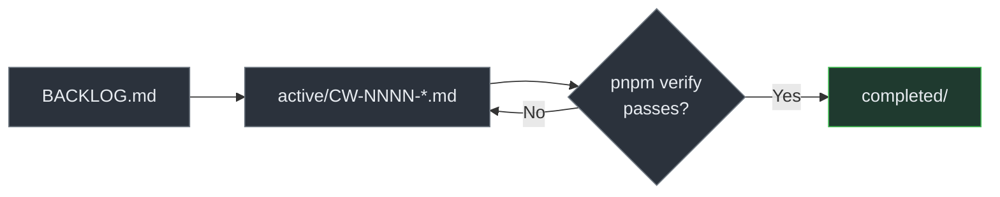

# Task Packets

> Audience: everyone, human and AI. Date: 2026-07-28.

A **task packet** is a file describing one unit of work: what it is, what it may touch, what
"done" means, what was actually done, and what is left.

---

## Why files and not a chat

**A conversation is not project memory.**

When a session ends, everything decided in it that was not written down is gone. The next
person — or the next agent — starts from the code and guesses at the reasoning. That guess is
usually wrong in a small way that compounds.

A task packet is:

- **durable** — it survives the session, and it is in Git;
- **reviewable** — someone can disagree with the plan before the work happens;
- **a handoff** — another person or agent can pick it up mid-flight;
- **honest** — it records what was actually run and what actually failed.

## What it is not

**Not a replacement for Git history.** Git records what changed. A packet records _why_, what
was considered, and what was verified. They answer different questions and neither substitutes
for the other.

**Not a ticket tracker.** No sprints, no points, no burndown.

**Not required for everything.** A typo fix does not need a packet.

---

## When to use one

| Work                                               | Packet?                          |
| -------------------------------------------------- | -------------------------------- |
| A new feature or domain                            | **Yes**                          |
| A change touching currency, inventory or ownership | **Yes**                          |
| A migration                                        | **Yes**                          |
| A multi-session piece of work                      | **Yes**                          |
| Anything an AI agent does that is non-trivial      | **Yes**                          |
| A one-line bug fix                                 | No                               |
| A formatting change                                | No                               |
| A dependency bump                                  | No, unless it is a major version |

---

## Layout

```text
docs/tasks/
├── BACKLOG.md                  What is next, and why, in order
├── active/                     In progress — CW-NNNN-kebab-title.md
├── completed/                  Done and verified
└── templates/
    └── TASK_PACKET_TEMPLATE.md
```

Ids are sequential: `CW-0001`, `CW-0002`. They never get reused.

---

## Lifecycle



**A packet moves to `completed/` only when:**

- [ ] Every acceptance criterion is met.
- [ ] `pnpm verify` passes, and its **real output** is recorded.
- [ ] Anything skipped or blocked is stated explicitly, with the reason.
- [ ] Documentation is updated in the same change.
- [ ] Status documents reflect reality.
- [ ] No unsupported completion claim remains anywhere in the packet.

**Partial completion is a legitimate outcome.** A packet recording "eleven of twelve gates
pass; the twelfth is blocked because Docker is not installed" is a good packet. One claiming
twelve is a broken project. See [AI agent rules](../constitution/AI_AGENT_RULES.md).

---

## Filling one in

The template has many fields. They are not bureaucracy — each one exists because leaving it
out has caused a real problem somewhere:

| Field                         | Prevents                                            |
| ----------------------------- | --------------------------------------------------- |
| **Non-goals**                 | Scope creep discovered at review time               |
| **Allowed / forbidden files** | An agent refactoring something unrelated            |
| **Assumptions**               | A decision made silently that turns out to be wrong |
| **Commands executed**         | A claim that something was verified when it was not |
| **Results**                   | A summary that describes intent rather than outcome |
| **Remaining work**            | Work quietly dropped between sessions               |
| **Handoff**                   | The next person re-deriving everything              |

Fields that genuinely do not apply get "N/A" and a reason — not silence, which is
indistinguishable from an oversight.

---

## Current

**Active:**

- [CW-0001 — Development platform bootstrap](active/CW-0001-development-platform-bootstrap.md)
- [CW-0002 — Canonical architecture and domain specification package](active/CW-0002-canonical-architecture-and-domain-specifications.md)

**Next:** see [BACKLOG.md](BACKLOG.md).

Related: [AI agent rules](../constitution/AI_AGENT_RULES.md) ·
[AI agent operations](../runbooks/AI_AGENT_OPERATIONS.md) ·
[Specifications](../specifications/README.md)
